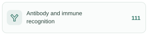
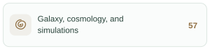
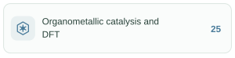
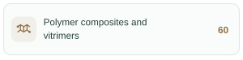

<a id="top"></a>

<h1 align="center">ScienceEvolve</h1>

<p align="center">
  <strong>Build, run, and improve your own science research workflow, and evolve it.</strong>
</p>

<p align="center">
  <strong>English</strong> | <a href="./README_zh-CN.md#top">简体中文</a>
</p>

<p align="center">
<a href="#sdk"></a>
<a href="#quick-start"></a>
<a href="#features"></a>
<a href="#skills-overview"></a>
<a href="#dual-loops"></a>
<a href="#tutorial"></a>
<a href="#examples"></a>
<a href="https://arxiv.org/abs/2607.03863" title="Rethinking Scientific Discovery in the Agentic Era"></a>
<a href="#configuration"></a>
</p>

---

ScienceEvolve is the autonomous version of the research framework presented in [Rethinking Scientific Discovery in the Agentic Era](https://arxiv.org/abs/2607.03863). It connects research, experiments, coding, and review in a workflow. Build an Agent team, follow its execution, improve the task using real feedback, and authorize Main to evolve the workflow itself.

<a id="sdk"></a>

**🧩 Two ways to use ScienceEvolve** — shared workflow semantics, with an interface for your way of working.

[](#quick-start) — **This repository.** Run workflows from TypeScript or the command line and embed research in your own services. See the [SDK examples](example/README_en.md) and [Web / SDK comparison](sdk/docs/main-sdk-parity.md).

[](https://github.com/OpenMOSS/ScienceEvolve-server) — **Web / Server entry.** Compose Agents visually, connect model gateways, manage research projects, and inspect traces and delivered files.

## Your research team, one workflow

> “Here is a Poisson solver. Explore two improvements, validate convergence, compare the errors, and write a report.”

Connect planning, parallel exploration, implementation, and review in `workflow.json`. Main coordinates the work and confirms completion; Workers handle research, experiments, coding, and review. Each Agent can select **Codex, Claude Code, DSH, pi, or Hermes**, with its own model, prompt, Skills, and MCP tools.

<div align="center">


</div>

<a id="dual-loops"></a>

## Two feedback loops: improve the task and the process

The **task loop** runs a method, collects real feedback, improves the method, and runs again. The **process loop** reviews the research results and updates Agent responsibilities, tools, or routing before continuing. Start with a fixed workflow and enable process evolution when needed.

<div align="center">


</div>

**Evolver is part of the team.** In the current implementation, Main takes this role when authorized to reconfigure dynamically. Main submits `workflow.json` and calls `apply_workflow`; SDK Runtime validates the proposal before applying it. Actual task evaluation determines whether the change helps.

<div align="center">


</div>

[Main / Worker and orchestration](sdk/skills/scienceevolve-sdk/references/workflow-en.md) · [Dynamic reconfiguration scope](sdk/skills/scienceevolve-sdk/references/workflow-en.md#main-reconfiguration)

<a id="skills-overview"></a>

## 🧠 Research Skills

ScienceEvolve distills methods from published research into **reusable scientific workflows**. Agents can frame a research question, formulate hypotheses, design validation, analyze evidence, and adapt their next steps to the results, bringing domain methods into their own research process.

**875 scientific methods across 12 research areas, distilled from 70,000+ published papers.**

- **🧭 Research design**: define applicability and required inputs, organize testable hypotheses, variables, controls, and research steps, and specify expected outputs.
- **🔎 Evidence and validation**: establish validation gates and claim boundaries, distinguishing verified facts, inferences, and untested hypotheses so conclusions remain tied to evidence.
- **🔄 Feedback and iteration**: identify failure modes and define when to repeat validation, revise the study, or pivot if evidence is insufficient or observations contradict a hypothesis.

Select task-relevant Skills for different Agents and provide the research goal, existing evidence, and available resources to guide research planning and result analysis. **The reusable part is the research method; conclusions still require evidence and validation from the current study.**

<p>
<a href=".agents/skills/scientific/immune-recognition/README.md#top"></a>
<a href=".agents/skills/scientific/aqueous-batteries/README.md#top"></a>
<a href=".agents/skills/scientific/asymmetric-catalysis/README.md#top"></a>
<br>
<a href=".agents/skills/scientific/chromatin-regulation/README.md#top"></a>
<a href=".agents/skills/scientific/quantum-materials/README.md#top"></a>
<a href=".agents/skills/scientific/fiber-composites/README.md#top"></a>
<br>
<a href=".agents/skills/scientific/cosmology/README.md#top"></a>
<a href=".agents/skills/scientific/fusion/README.md#top"></a>
<a href=".agents/skills/scientific/neuromorphic-computing/README.md#top"></a>
<br>
<a href=".agents/skills/scientific/organometallic-catalysis/README.md#top"></a>
<a href=".agents/skills/scientific/polymer-composites/README.md#top"></a>
<a href=".agents/skills/scientific/urban-resilience/README.md#top"></a>
</p>

<sub>Browse Skills by area &nbsp; · &nbsp; <a href="#scientific-skills">Usage and examples</a> &nbsp; · &nbsp; <a href=".agents/skills/README.md#top">All Skills</a></sub>

<a id="features"></a>

## Features

### Let Main evolve the workflow

Authorized Main can add or remove Agents, change responsibilities and paths, switch Harnesses, and submit an updated workflow. SDK Runtime validates before applying the proposal so the team can adapt to the task. [Editable scope](sdk/skills/scienceevolve-sdk/references/workflow-en.md#main-reconfiguration).

<div align="center">


</div>

### Set Loop rounds and the exit Agent

Main starts a finite-element mesh convergence experiment. Coder → Executor → Review runs for three complete rounds, then exits to the selected Writer Agent, which delivers the error analysis report (errors.md). Both the number of rounds and exit Agent are configurable. [Configure SDK Loops](sdk/docs/workflow-loops.md).

<div align="center">


</div>

### Revert and retry from experiment evidence

With Git collaboration enabled, Idea proposes a larger simulation time step. Execution implements and merges it, but evaluation regresses. The authorized Review Agent uses `git_revert` on its current task branch to restore the accepted code and rerun the benchmark. The revert is a new commit; the failed change remains in history. [Configure Git credentials and workflows](sdk/docs/main-cli.md#github-authentication-and-git-collaboration).

<div align="center">


</div>

### Review and integrate parallel contributions

With Git collaboration enabled, Agents work in isolated worktrees. Collaboration groups organize parallel exploration, with review and PR integration at each level. [Configure a GitHub account](sdk/docs/main-cli.md#github-authentication-and-git-collaboration).

<div align="center">


</div>

### Resume interrupted work

System Runtime retains project state, completed progress, and execution traces. Recoverable interruptions can resume through review and delivery. Check actual external processes and results before continuing external jobs.

<div align="center">


</div>

### Keep adjusting in natural language

Describe new goals and changes through task input. Main, when authorized to reconfigure, can update Agents, Loops, and collaboration groups through the [SDK workflow update mechanism](sdk/skills/scienceevolve-sdk/references/workflow-en.md#main-reconfiguration). Use `run.addInput()` for follow-up requirements and `run.respond()` to answer task questions.

<div align="center">


</div>

<a id="scientific-skills"></a>

## Skill usage and examples

**875 scientific method Skills across 12 areas, plus 24 supporting Skills for research and writing.**

<a id="scientific-methods"></a>

### Scientific methods · 12 areas / 875 Skills

The methods cover hypothesis generation, research design, experimental validation, evidence analysis, and iteration. Browse each area using the category cards above.

Each Skill defines applicability, inputs, steps, outputs, validation gates, claim boundaries, and failure handling. Categories organize browsing; existing `builtin:<name>` references remain unchanged.

<details>
<summary><strong>Inside a Skill: asymmetric catalysis research design</strong></summary>

The [chiral catalyst research-design Skill](.agents/skills/scientific/asymmetric-catalysis/sci-catalysis-asymmetric-catalysis-chiral-catalyst-rese-1571cd89/SKILL.md) guides an Agent through:

> Frame the problem → generate competing hypotheses → design minimal validation → analyze evidence → iterate or pivot.

It asks for the target transformation, existing evidence, candidate mechanisms, and available analytical methods. Each stage defines a decision gate: when the evidence cannot distinguish hypotheses, revisit the validation design; when the observations conflict with the mechanism, revise the hypothesis. Outputs include a research plan, controls, decision criteria, and bounded conclusions.

</details>

**Use in the SDK:** select a Skill from the catalog and set its `builtin:` ID in an existing Agent’s `skills` or `autoSkills`. For example, add this to the target Agent configuration:

```json
{
  "skills": [
    "builtin:sci-catalysis-asymmetric-catalysis-chiral-catalyst-rese-1571cd89"
  ]
}
```

The SDK build bundles all 875 method Skills in `assets/skills`; no separate download is needed. Fixed Skills load on each invocation; automatic selection depends on the chosen Harness.

When Main is authorized to reconfigure the workflow, it can adjust Skill selections as the research progresses. Actual data, tools, and experimental environments are configured for the task.

[Browse all research areas](.agents/skills/scientific/README.md#top)

<a id="general-skills"></a>

### Supporting research & writing Skills · 24

Research direction, ideation, literature research, experiment design, writing, figures, and review, plus Inspire experiment guidance.

- **Team roles · 5**: research direction, ideation, experiment execution, writing, and review.
- **Research, writing, and review · 15**: CCFA, Nature-style, and integrated writing methods.
- **Experiment operations · 1**: Inspire operations and experiment resources.
- **Agent4Sci · 3**: literature-grounded research, experiment execution, and strategic checks. Select all three fixed Skills for the complete flow; checklist runs on demand. [Configuration and example](sdk/docs/agent4sci.md).

[Browse research & writing Skills](.agents/skills/general/README.md#top)

<a id="quick-start"></a>

## Quick start

You need **Node.js 24+**, **npm 10+**, Git to clone the source, and a model gateway. This starter uses the bundled **pi** Harness and a Chat Completions gateway with `reasoning_effort: high` support.

### 1. Install the SDK and CLI

Clone the repository's `main` branch and install:

```sh
git clone --branch main --single-branch https://github.com/OpenMOSS/ScienceEvolve.git ScienceEvolve
cd ScienceEvolve
npm ci
npm run install:cli
scievolve --help
```

Keep this terminal in the repository root. Create an empty task directory, such as `/absolute/todo-project`, and choose a separate absolute `/absolute/scienceevolve-data` directory for runtime state. Replace these paths in the commands below; neither directory may contain the other.

### 2. Connect and test a model

Set `MODEL_API_KEY` in the startup environment. In Bash use `export MODEL_API_KEY='YOUR_KEY'`; in PowerShell use `$env:MODEL_API_KEY = 'YOUR_KEY'`.

Save the following as `reasoning.json` in the repository root. Replace `YOUR_MODEL` here and in the commands with the same model ID from your provider:

```json
{
  "YOUR_MODEL": {
    "parameter": "reasoning_effort",
    "options": [{ "id": "high", "label": "High", "value": "high" }]
  }
}
```

```sh
scievolve gateway add --data-dir /absolute/scienceevolve-data --name research --url https://YOUR_PROVIDER/v1 --protocol chat-completions --models YOUR_MODEL --default-model YOUR_MODEL --key-env MODEL_API_KEY --reasoning-file reasoning.json
scievolve gateway test GATEWAY_ID --data-dir /absolute/scienceevolve-data --model YOUR_MODEL --harness pi --reasoning-option high
```

Use the gateway ID returned by `gateway add` as `GATEWAY_ID`. Continue when the connection test passes. For other protocols, reasoning parameters, per-Agent models, or Codex native login, see the [model configuration guide](sdk/docs/main-cli.md#deployment-and-startup).

### 3. Run a Workflow

Start with [software development and testing](example/02-software-development/workflow.json). It builds a Node.js Todo CLI, then tests and repairs it in the task directory:

```sh
scievolve workflow validate example/02-software-development/workflow.json
scievolve start example/02-software-development/workflow.json example/02-software-development/research_proposal.txt --data-dir /absolute/scienceevolve-data --workspace /absolute/todo-project --gateway GATEWAY_ID --model YOUR_MODEL --harness pi
```

The CLI streams events and prints the run ID and final status. When the status is `completed`, inspect the source, tests, and usage instructions in your task directory, with execution records under `development/`. To pause, press **Ctrl+C**, wait for shutdown, and use the printed resume command with the same data directory.

<a id="tutorial"></a>

## SDK tutorial: from a first task to your own workflow

**① Finish your first task.** Follow the quick start above, then inspect the delivered code and run its tests. Add files or images with `--inputs`, and use `run input` / `run respond` for follow-up requirements and answers. See [inputs](sdk/docs/project-inputs.md), [workspaces](sdk/examples/workspace-examples-en.md), and [pause and recovery](sdk/docs/main-cli.md#stop-recovery-and-results).

**② Compose your own workflow.** Copy a workflow and edit its Agent roles, routes, completion criteria, and Loops. Use Git-on collaboration groups for isolated parallel work, and enable `orchestration.allowMainReconfiguration` when Main should evolve the process. The [authoring Skill](sdk/skills/scienceevolve-sdk/README_en.md), [workflow reference](sdk/skills/scienceevolve-sdk/references/workflow-en.md), and [Loop guide](sdk/docs/workflow-loops.md) explain these settings. Validate the configuration before starting it.

### Embed it in Node.js

After the gateway setup above, save this as `run.mjs` in the repository root and run `node run.mjs`. Use the same paths, model, and tested gateway ID:

```js
import { readFile } from 'node:fs/promises';
import { resolve } from 'node:path';
import { createResearchSdk, loadWorkflowConfig, bindWorkflowConfig } from '@scienceevolve/sdk';

const workflow = bindWorkflowConfig(
  await loadWorkflowConfig(resolve('example/02-software-development/workflow.json')),
  { model: 'YOUR_MODEL', harness: 'pi' }
);
const sdk = await createResearchSdk({ dataDir: '/absolute/scienceevolve-data' });
try {
  const run = await sdk.start({
    title: 'Todo CLI', workflow,
    requirement: await readFile('example/02-software-development/research_proposal.txt', 'utf8'),
    workspace: '/absolute/todo-project',
    gatewayBindings: { defaultGatewayId: 'GATEWAY_ID' }
  });
  console.log('runId', run.id);
  for await (const event of run.events()) console.log(event);
  const result = await run.wait();
  console.log(result.status, result.artifacts);
  if (result.status !== 'completed') process.exitCode = 2;
} finally {
  await sdk.close();
}
```

`wait()` also returns when a run is paused or interrupted; check `status` before accepting its result. For integration in another Node project, install the SDK there as a dependency. See the [package guide](sdk/README.md) and [API / lifecycle reference](sdk/skills/scienceevolve-sdk/references/usage-en.md#esm-api).

<a id="examples"></a>
<a id="research-papers-and-method-examples"></a>
<a id="科研论文与方法示例"></a>
<a id="补充方法流程"></a>

## Examples

We implement or adapt workflow structures from published papers and open-source projects as ScienceEvolve configurations, including Agent roles, routing, and feedback loops. Credit belongs to the original authors; the table links the **original work, official project, and our implementation**.

Choose from **23 workflows, including three introductory workflows**. Select a workflow and a concrete research proposal from [example/](example/README_en.md). Each `research_proposal.txt` describes a question, hypothesis, data, and evaluation plan. Prepare the resources in [runtime setup](example/RUNTIME.md), then start through the CLI or Node API. These are illustrative research topics, not claims of reproducing the original papers.

### Start with three introductory workflows

[Software development and testing](example/02-software-development/workflow.json) — coding, independent testing, and repair. · [AHE code evolution](example/01-ahe-evolve/workflow.json) — execution, evaluation, optimization, and batch decisions. · [General research](example/dynamic-research-workflow/workflow.json) — ideation, execution, writing, review, and Main coordination.

### Workflows from papers and open-source projects

<table>
<thead>
<tr><th align="left">Method</th><th align="left">Original paper</th><th align="left">Official code / project</th><th align="left">Our workflow</th></tr>
</thead>
<tbody><tr><td align="left"><a href="example/01-ahe-evolve/workflow.json">AHE code evolution</a></td><td align="left"><a href="https://arxiv.org/abs/2604.25850" title="Agentic Harness Engineering: Observability-Driven Automatic Evolution of Coding-Agent Harnesses">arXiv:2604.25850</a></td><td align="left"><a href="https://github.com/china-qijizhifeng/agentic-harness-engineering">agentic-harness-engineering</a></td><td align="left"><a href="example/01-ahe-evolve/workflow.json">JSON</a> · <a href="example/01-ahe-evolve/research_proposal.txt">Proposal</a></td></tr>
<tr><td align="left"><a href="example/aris/workflow.json">ARIS</a></td><td align="left"><a href="https://arxiv.org/abs/2605.03042" title="ARIS: Autonomous Research via Adversarial Multi-Agent Collaboration">arXiv:2605.03042</a></td><td align="left"><a href="https://github.com/wanshuiyin/Auto-claude-code-research-in-sleep" title="wanshuiyin/Auto-claude-code-research-in-sleep">ARIS</a></td><td align="left"><a href="example/aris/workflow.json">JSON</a> · <a href="example/aris/research_proposal.txt">Proposal</a></td></tr>
<tr><td align="left"><a href="example/metaharness/workflow.json">Meta-Harness</a></td><td align="left"><a href="https://arxiv.org/abs/2603.28052" title="Meta-Harness: End-to-End Optimization of Model Harnesses">arXiv:2603.28052</a></td><td align="left"><a href="https://github.com/stanford-iris-lab/meta-harness">meta-harness</a></td><td align="left"><a href="example/metaharness/workflow.json">JSON</a> · <a href="example/metaharness/research_proposal.txt">Proposal</a></td></tr>
<tr><td align="left"><a href="example/autoresearch/workflow.json">autoresearch</a></td><td align="left">— (project source)</td><td align="left"><a href="https://github.com/karpathy/autoresearch">autoresearch</a></td><td align="left"><a href="example/autoresearch/workflow.json">JSON</a> · <a href="example/autoresearch/research_proposal.txt">Proposal</a></td></tr>
<tr><td align="left"><a href="example/funsearch/workflow.json">FunSearch</a></td><td align="left"><a href="https://www.nature.com/articles/s41586-023-06924-6" title="Mathematical discoveries from program search with large language models">Nature 2023</a></td><td align="left"><a href="https://github.com/google-deepmind/funsearch">funsearch</a></td><td align="left"><a href="example/funsearch/workflow.json">JSON</a> · <a href="example/funsearch/research_proposal.txt">Proposal</a></td></tr>
<tr><td align="left"><a href="example/agent-laboratory/workflow.json">Agent Laboratory</a></td><td align="left"><a href="https://arxiv.org/abs/2501.04227" title="Agent Laboratory: Using LLM Agents as Research Assistants">arXiv:2501.04227</a></td><td align="left"><a href="https://github.com/SamuelSchmidgall/AgentLaboratory">AgentLaboratory</a></td><td align="left"><a href="example/agent-laboratory/workflow.json">JSON</a> · <a href="example/agent-laboratory/research_proposal.txt">Proposal</a></td></tr>
<tr><td align="left"><a href="example/sciagents/workflow.json">SciAgents</a></td><td align="left"><a href="https://arxiv.org/abs/2409.05556" title="SciAgents: Automating scientific discovery through multi-agent intelligent graph reasoning">arXiv:2409.05556</a></td><td align="left"><a href="https://github.com/lamm-mit/SciAgentsDiscovery">SciAgentsDiscovery</a></td><td align="left"><a href="example/sciagents/workflow.json">JSON</a> · <a href="example/sciagents/research_proposal.txt">Proposal</a></td></tr>
<tr><td align="left"><a href="example/robin/workflow.json">Robin</a></td><td align="left"><a href="https://arxiv.org/abs/2505.13400v1" title="Robin: A multi-agent system for automating scientific discovery">arXiv:2505.13400</a></td><td align="left"><a href="https://github.com/Future-House/robin">robin</a></td><td align="left"><a href="example/robin/workflow.json">JSON</a> · <a href="example/robin/research_proposal.txt">Proposal</a></td></tr>
<tr><td align="left"><a href="example/co-scientist/workflow.json">Google AI co-scientist</a></td><td align="left"><a href="https://arxiv.org/abs/2502.18864v1" title="Towards an AI co-scientist">arXiv:2502.18864</a></td><td align="left">— †</td><td align="left"><a href="example/co-scientist/workflow.json">JSON</a> · <a href="example/co-scientist/research_proposal.txt">Proposal</a></td></tr>
<tr><td align="left"><a href="example/biomni/workflow.json">Biomni A1 / E1</a></td><td align="left"><a href="https://www.biorxiv.org/content/10.1101/2025.05.30.656746v1" title="Biomni: A General-Purpose Biomedical AI Agent">bioRxiv 2025</a></td><td align="left"><a href="https://github.com/snap-stanford/Biomni">Biomni</a></td><td align="left"><a href="example/biomni/workflow.json">JSON</a> · <a href="example/biomni/research_proposal.txt">Proposal</a></td></tr>
<tr><td align="left"><a href="example/agentrxiv/workflow.json">AgentRxiv</a></td><td align="left"><a href="https://arxiv.org/abs/2503.18102" title="AgentRxiv: Towards Collaborative Autonomous Research">arXiv:2503.18102</a></td><td align="left"><a href="https://github.com/SamuelSchmidgall/AgentLaboratory">AgentLaboratory</a></td><td align="left"><a href="example/agentrxiv/workflow.json">JSON</a> · <a href="example/agentrxiv/research_proposal.txt">Proposal</a></td></tr>
<tr><td align="left"><a href="example/rrsi/workflow.json">RRSI</a></td><td align="left"><a href="https://arxiv.org/abs/2609.24972" title="RRSI: Regularized Recursive Self-Improvement of Agent Harnesses">arXiv:2609.24972</a></td><td align="left"><a href="https://github.com/google-research/rrsi">rrsi</a></td><td align="left"><a href="example/rrsi/workflow.json">JSON</a> · <a href="example/rrsi/research_proposal.txt">Proposal</a></td></tr>
<tr><td align="left"><a href="example/drugevolve/workflow.json">DrugEvolve</a></td><td align="left"><a href="https://www.biorxiv.org/content/10.64898/2026.08.16.745117v1" title="An AI System for Autonomous Algorithm Evolution in Drug Development">bioRxiv 2026</a></td><td align="left"><a href="https://github.com/GAIR-NLP/DrugEvolve">DrugEvolve</a></td><td align="left"><a href="example/drugevolve/workflow.json">JSON</a> · <a href="example/drugevolve/research_proposal.txt">Proposal</a></td></tr>
<tr><td align="left"><a href="example/scientist-two/workflow.json">ScientistTwo</a></td><td align="left"><a href="https://arxiv.org/abs/2609.19644v1" title="ScientistTwo: Pioneering the Human Knowledge Frontier with Autonomous AI">arXiv:2609.19644</a></td><td align="left">— †</td><td align="left"><a href="example/scientist-two/workflow.json">JSON</a> · <a href="example/scientist-two/research_proposal.txt">Proposal</a></td></tr>
<tr><td align="left"><a href="example/ai-scientist-v2/workflow.json">AI Scientist v2</a></td><td align="left"><a href="https://arxiv.org/abs/2504.08066" title="The AI Scientist-v2: Workshop-Level Automated Scientific Discovery via Agentic Tree Search">arXiv:2504.08066</a></td><td align="left"><a href="https://github.com/SakanaAI/AI-Scientist-v2">AI-Scientist-v2</a></td><td align="left"><a href="example/ai-scientist-v2/workflow.json">JSON</a> · <a href="example/ai-scientist-v2/research_proposal.txt">Proposal</a></td></tr>
<tr><td align="left"><a href="example/internagent-1-5/workflow.json">InternAgent 1.5</a></td><td align="left"><a href="https://arxiv.org/abs/2602.08990" title="InternAgent-1.5: A Unified Agentic Framework for Long-Horizon Autonomous Scientific Discovery">arXiv:2602.08990</a></td><td align="left"><a href="https://github.com/InternScience/InternAgent">InternAgent</a></td><td align="left"><a href="example/internagent-1-5/workflow.json">JSON</a> · <a href="example/internagent-1-5/research_proposal.txt">Proposal</a></td></tr>
<tr><td align="left"><a href="example/biomni-r0/workflow.json">Biomni-R0</a></td><td align="left"><a href="https://biomni.stanford.edu/blog/biomni-r0-technical-report" title="Biomni-R0 technical report">Technical report</a></td><td align="left"><a href="https://github.com/snap-stanford/Biomni">Biomni</a></td><td align="left"><a href="example/biomni-r0/workflow.json">JSON</a> · <a href="example/biomni-r0/research_proposal.txt">Proposal</a></td></tr>
<tr><td align="left"><a href="example/chemical-coscientist/workflow.json">Chemical Coscientist</a></td><td align="left"><a href="https://www.nature.com/articles/s41586-023-06792-0" title="Autonomous chemical research with large language models">Nature 2023</a></td><td align="left"><a href="https://github.com/gomesgroup/coscientist">coscientist</a></td><td align="left"><a href="example/chemical-coscientist/workflow.json">JSON</a> · <a href="example/chemical-coscientist/research_proposal.txt">Proposal</a></td></tr>
<tr><td align="left"><a href="example/raven/workflow.json">Raven Host</a></td><td align="left"><a href="https://arxiv.org/abs/2609.33439" title="Raven: The Harness of Harnesses for Composable Agentic Intelligence">arXiv:2609.33439</a></td><td align="left"><a href="https://github.com/EverMind-AI/Raven">Raven</a></td><td align="left"><a href="example/raven/workflow.json">JSON</a> · <a href="example/raven/research_proposal.txt">Proposal</a></td></tr>
<tr><td align="left"><a href="example/kosmos/workflow.json">Kosmos</a></td><td align="left"><a href="https://arxiv.org/abs/2511.02824">arXiv:2511.02824</a></td><td align="left"><a href="https://github.com/EdisonScientific/kosmos-figures">Figures and analysis</a></td><td align="left"><a href="example/kosmos/workflow.json">JSON</a> · <a href="example/kosmos/research_proposal.txt">Proposal</a></td></tr>
<tr><td align="left"><a href="example/alphaevolve/workflow.json">AlphaEvolve</a></td><td align="left"><a href="https://arxiv.org/abs/2506.13131">arXiv:2506.13131</a></td><td align="left"><a href="https://github.com/google-deepmind/alphaevolve_repository_of_problems">Problems and verifiers</a></td><td align="left"><a href="example/alphaevolve/workflow.json">JSON</a> · <a href="example/alphaevolve/research_proposal.txt">Proposal</a></td></tr>
</tbody></table>

† Google AI co-scientist and ScientistTwo follow the published papers; AgentRxiv code is included in Agent Laboratory. Pinned versions and method mappings are recorded in project manifests and the shared [SOURCES.json](example/SOURCES.json).

<details>
<summary><strong>Workflow structures in the Web editor</strong></summary>

These Web canvas screenshots from main illustrate the software and AHE workflow structures. Run them in the SDK using the JSON configurations and CLI above.


</details>

[Complete example index and startup instructions](example/README_en.md) · [Shared method sources](example/SOURCES.json)

## Built-in Skill sources and acknowledgements

The SDK bundles the runtime Skills from [`.agents/skills`](.agents/skills). Their upstream repositories and uses are listed below.

<table>
<thead>
<tr><th align="left">Built-in Skill / resource</th><th align="left">Upstream repository</th><th align="left">Use in ScienceEvolve</th></tr>
</thead>
<tbody><tr><td align="left"><code>ccf-common</code>, <code>ccf-experiment-designer</code>, <code>ccf-idea-optimizer</code>, <code>ccf-idea-reviewer</code>, <code>ccf-literature-monitor</code>, <code>ccf-literature-searcher</code>, <code>ccf-paper-reviewer</code>, <code>ccf-paper-to-exemplar</code>, <code>ccf-paper-writer</code>, <code>ccf-visual-composer</code></td><td align="left"><a href="https://github.com/mikubaka88/CCFA-Skills">mikubaka88/CCFA-Skills</a></td><td align="left">Adapted research, writing, review, and visualization Skills.</td></tr>
<tr><td align="left"><code>nature-figure</code>, <code>nature-polishing</code>, <code>nature-shared</code>, <code>nature-writing</code></td><td align="left"><a href="https://github.com/Yuan1z0825/nature-skills">Yuan1z0825/nature-skills</a></td><td align="left">Integrated Nature-style writing, polishing, figures, and shared references.</td></tr>
<tr><td align="left"><code>awesome-ai-research-writing-director</code></td><td align="left"><a href="https://github.com/Leey21/awesome-ai-research-writing">Leey21/awesome-ai-research-writing</a></td><td align="left">Writing-method synthesis adapted to the manuscript output contract.</td></tr>
<tr><td align="left"><code>inspire</code></td><td align="left"><a href="https://github.com/realZillionX/InspireSkill">realZillionX/InspireSkill</a></td><td align="left">Platform guidance adapted to the SII MCP integration.</td></tr>
<tr><td align="left">Plotting references used by <code>nature-figure</code></td><td align="left"><a href="https://github.com/ChenLiu-1996/figures4papers">ChenLiu-1996/figures4papers</a></td><td align="left">Scientific figure design and plotting references.</td></tr>
</tbody></table>

Bundled Skills include ScienceEvolve-specific integration changes. The project role Skills `research-director`, `idea-agent`, `experiment-runner`, `latex-writer`, and `iclr-reviewer` are maintained in this repository. Thank you to the upstream authors and contributors.

The CCFA and Nature copies do not record import commits; their repository attribution is based on comparing Skill names and contents with upstream.

<a id="configuration"></a>
<a id="测试环境要求"></a>

## Configure what you need

Detailed guides are available in English and Chinese. Use the language links at the top of each guide.

<table>
<thead>
<tr><th align="left">Your task</th><th align="left">Guide</th></tr>
</thead>
<tbody>
<tr><td align="left">Install, connect models, and set reasoning options</td><td align="left"><a href="sdk/docs/main-cli.md#deployment-and-startup">CLI and gateways</a> · <a href="sdk/README.md">Package guide</a></td></tr>
<tr><td align="left">Change Harnesses or use native login</td><td align="left"><a href="sdk/docs/main-cli.md#deployment-json">Deployment</a> · <a href="sdk/docs/main-cli.md#codex-native-oauth-login">Codex login</a> · <a href="sdk/docs/hermes.md">Hermes</a></td></tr>
<tr><td align="left">Define Agents, routes, Loops, and reconfiguration</td><td align="left"><a href="sdk/skills/scienceevolve-sdk/references/workflow-en.md">Workflow reference</a> · <a href="sdk/docs/workflow-loops.md">Loops</a> · <a href="sdk/skills/scienceevolve-sdk/README_en.md">Authoring Skill</a></td></tr>
<tr><td align="left">Connect GitHub and run parallel collaboration</td><td align="left"><a href="sdk/docs/main-cli.md#github-authentication-and-git-collaboration">GitHub authentication</a> · <a href="sdk/examples/main-runtime/workflow.json">Git-on v3 example</a></td></tr>
<tr><td align="left">Provide inputs, choose workspaces, and deliver files</td><td align="left"><a href="sdk/docs/project-inputs.md">Shared inputs</a> · <a href="sdk/examples/workspace-examples-en.md">Workspaces</a></td></tr>
<tr><td align="left">Add Skills, MCP tools, or experiment platforms</td><td align="left"><a href="sdk/skills/scienceevolve-sdk/references/workflow-en.md#skills-and-mcp">Skills</a> · <a href="sdk/docs/project-mcp.md">MCP</a> · <a href="sdk/docs/sii-experiments.md">Inspire / SII</a></td></tr>
<tr><td align="left">Integrate Node APIs, subscribe to events, and recover</td><td align="left"><a href="sdk/skills/scienceevolve-sdk/references/usage-en.md#esm-api">API reference</a> · <a href="sdk/docs/main-cli.md#stop-recovery-and-results">Pause and recovery</a></td></tr>
<tr><td align="left">Develop the SDK, run tests, or upgrade a deployment</td><td align="left"><a href="docs/sdk/README_en.md#development-and-tests">Development and tests</a> · <a href="sdk/docs/naming-migration.md">Naming migration</a> · <a href="sdk/docs/main-runtime-migration.md">Runtime migration</a> · <a href="sdk/docs/main-sync-20261016.md">Runtime updates</a></td></tr>
</tbody>
</table>

<a id="resources"></a>

## Additional documentation links

<table>
<thead>
<tr><th align="left">Document</th><th align="left">Link</th></tr>
</thead>
<tbody>
<tr><td align="left">Research workflows</td><td align="left"><a href="sdk/skills/scienceevolve-sdk/references/workflow-en.md">Main / Worker roles and reconfiguration</a> · <a href="sdk/docs/workflow-loops.md">Loop settings</a></td></tr>
<tr><td align="left">SDK integration</td><td align="left"><a href="sdk/README.md">Package guide</a> · <a href="sdk/skills/scienceevolve-sdk/references/usage-en.md#esm-api">Node API and lifecycle</a></td></tr>
<tr><td align="left">Workflow examples and sources</td><td align="left"><a href="example/README_en.md">23 workflows and startup instructions</a> · <a href="example/SOURCES.json">Method sources</a></td></tr>
<tr><td align="left">Inspire / SII</td><td align="left"><a href=".agents/skills/general/inspire/references/setup/install-and-config-en.md">CLI installation</a> · <a href="sdk/docs/sii-experiments.md">SDK configuration</a></td></tr>
</tbody>
</table>
