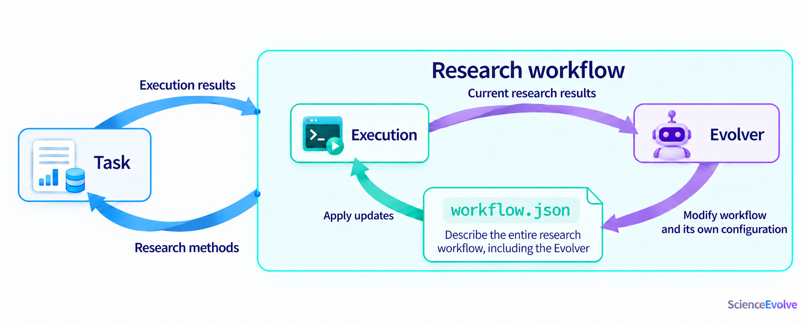
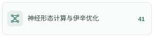

<a id="top"></a>

<h1 align="center">ScienceEvolve</h1>

<p align="center">
  <strong>构建、运行并持续改进自己的多 Agent 科研工作流，让工作流本身也能演化。</strong>
</p>

<p align="center">
  <a href="./README.md#top">English</a> | <strong>简体中文</strong>
</p>

<p align="center">
<a href="#sdk"></a>
<a href="#quick-start"></a>
<a href="#features"></a>
<a href="#skills-overview"></a>
<a href="#dual-loops"></a>
<a href="#tutorial"></a>
<a href="#examples"></a>
<a href="https://arxiv.org/abs/2607.03863" title="Rethinking Scientific Discovery in the Agentic Era"></a>
<a href="#configuration"></a>
</p>

---

ScienceEvolve 是论文 [Rethinking Scientific Discovery in the Agentic Era](https://arxiv.org/abs/2607.03863) 所介绍科研框架的自主运行版本，将研究、实验、编码和评审连接成工作流。你可以组建自己的 Agent 团队，查看真实执行轨迹，让团队根据评估反馈改进任务，也可以授权 Main 调整工作流本身。

<a id="sdk"></a>

**🧩 ScienceEvolve 的两种使用方式** — 同一套工作流语义，按你的工作方式选择入口。

[](#quick-start) — **当前仓库**。通过 TypeScript 或命令行运行工作流，将研究流程接入自己的代码与服务。参见 [SDK 示例](example/README.md)与 [Web / SDK 对照](sdk/docs/main-sdk-parity-zh.md)。

[](https://github.com/OpenMOSS/ScienceEvolve-server) — **Web / Server 入口**。在网页中编排 Agent、连接模型网关、管理研究项目，查看轨迹与交付文件。

## 组建自己的科研 Agent 团队

> “这里有一个泊松方程求解器。请探索两种改进方案，验证收敛性，比较误差，并整理成报告。”

在 `workflow.json` 中连接计划、并行探索、实现和评审。Main 负责协调任务与确认完成，Worker 负责研究、实验、编码和评审等具体工作；每个 Agent 可独立选择 **Codex、Claude Code、DSH、pi 或 Hermes**，并配置模型、提示词、Skills 与 MCP 工具。

<div align="center">


</div>

<a id="dual-loops"></a>

## 双循环：改进任务，也改进研究流程

**任务循环**：执行任务 → 获取真实反馈 → 改进方法 → 再次执行。**流程循环**：回看研究结果 → 调整 Agent 分工、工具或连接关系 → 用更新后的工作流继续研究。你可以从固定工作流开始，按需要开启流程演化。

<div align="center">


</div>

**Evolver 就在研究团队中。** 当前实现由获得动态重配置授权的 Main 承担这一职责。Main 提交 `workflow.json` 并调用 `apply_workflow`，SDK Runtime 校验后应用；研究方法是否因此变好，仍要用实际任务评估。

<div align="center">



</div>

[Main / Worker 与编排](sdk/skills/scienceevolve-sdk/references/workflow.md) · [动态重配置范围](sdk/skills/scienceevolve-sdk/references/workflow.md#main-自修改)

<a id="skills-overview"></a>

## 🧠 科研 Skills

ScienceEvolve 将已发表研究中的方法提炼为**可复用的科研流程**。Agent 可以围绕当前课题明确研究问题、提出假设、设计验证、分析证据，再根据结果调整下一步，把领域方法融入自己的研究过程。

**875 个科研方法，覆盖 12 个研究领域，从 7 万余篇已发表论文中提炼。**

- **🧭 研究设计**：明确适用场景与所需输入，组织可检验的假设、变量、对照和研究步骤，约定预期产出。
- **🔎 证据与验证**：设置验证条件和结论边界，区分已验证事实、推断与待检验假设，让结论与证据对应。
- **🔄 反馈与迭代**：识别失败模式；当证据不足、观测与假设矛盾时，给出复验、修订研究方案或转向的判断条件。

为团队中不同 Agent 选择与课题相关的 Skill，并提供研究目标、已有证据和可用资源，即可将这些方法用于研究规划与结果分析。**复用的是研究方法，具体结论仍需由当前课题的证据和验证支持。**

<p>
<a href=".agents/skills/scientific/immune-recognition/README_zh-CN.md#top"></a>
<a href=".agents/skills/scientific/aqueous-batteries/README_zh-CN.md#top"></a>
<a href=".agents/skills/scientific/asymmetric-catalysis/README_zh-CN.md#top"></a>
<br>
<a href=".agents/skills/scientific/chromatin-regulation/README_zh-CN.md#top"></a>
<a href=".agents/skills/scientific/quantum-materials/README_zh-CN.md#top"></a>
<a href=".agents/skills/scientific/fiber-composites/README_zh-CN.md#top"></a>
<br>
<a href=".agents/skills/scientific/cosmology/README_zh-CN.md#top"></a>
<a href=".agents/skills/scientific/fusion/README_zh-CN.md#top"></a>
<a href=".agents/skills/scientific/neuromorphic-computing/README_zh-CN.md#top"></a>
<br>
<a href=".agents/skills/scientific/organometallic-catalysis/README_zh-CN.md#top"></a>
<a href=".agents/skills/scientific/polymer-composites/README_zh-CN.md#top"></a>
<a href=".agents/skills/scientific/urban-resilience/README_zh-CN.md#top"></a>
</p>

<sub>点击分类浏览技能 &nbsp; · &nbsp; <a href="#scientific-skills">技能使用与示例</a> &nbsp; · &nbsp; <a href=".agents/skills/README_zh-CN.md#top">全部 Skills</a></sub>

<a id="features"></a>

## 核心功能

### 让 Main 调整工作流

获得授权后，Main 可以增删 Agent、调整职责和路径、切换 Harness，并提交新的工作流。SDK Runtime 校验通过后再应用；团队可根据当前任务重新分工。[查看配置范围](sdk/skills/scienceevolve-sdk/references/workflow.md#main-自修改)。

<div align="center">


</div>

### 设置 Loop 轮次与退出 Agent

Main 发起有限元网格收敛实验，Coder → Executor → Review 整组运行 3 轮后，退出到用户指定的 Writer，由其交付误差评估报告（errors.md）。轮数与退出 Agent 均可配置。[查看 SDK Loop 配置](sdk/docs/workflow-loops-zh.md)。

<div align="center">


</div>

### 根据实验结果回滚重试

启用 Git 协作后，Idea 将增大仿真时间步长的方案交给 Execution。候选变更集成后评分下降，获授权的 Review 在当前任务分支使用 `git_revert` 恢复已接受的代码并复验；撤销形成新提交，原提交与失败实验保留。[配置 Git 凭据与工作流](sdk/docs/main-cli-zh.md#github-认证与-git-协作)。

<div align="center">


</div>

### 并行修改，评审后集成

启用 Git 协作后，Agent 在独立 worktree 中完成修改，使用协作组组织并行探索，再通过评审与逐级 Pull Request 集成结果。[配置 GitHub 账号](sdk/docs/main-cli-zh.md#github-认证与-git-协作)。

<div align="center">


</div>

### 从中断处继续执行

System Runtime 保存项目状态、已完成进度和执行轨迹。可恢复的中断经恢复后继续推进评审与交付；涉及外部作业时，先核对实际进程与结果。

<div align="center">


</div>

### 用自然语言持续调整

通过任务输入表达新的目标和调整要求。获得动态重配置授权的 Main 可据此编辑 Agent、循环和协作组，再经 [SDK 工作流更新机制](sdk/skills/scienceevolve-sdk/references/workflow.md#main-自修改)校验应用。使用 `run.addInput()` 补充要求，用 `run.respond()` 回答任务提问。

<div align="center">


</div>

<a id="scientific-skills"></a>

## Skills 使用与示例

**875 个领域科研方法技能，覆盖 12 个领域；另提供 24 个研究与写作辅助技能。**

<a id="scientific-methods"></a>

### 领域科研方法 · 12 个领域 / 875 个技能

覆盖假设生成、研究设计、实验验证、证据分析与迭代。可通过上面的分类卡片浏览各领域的方法。

每个 Skill 包含适用场景、所需输入、研究步骤、预期输出、验证条件、结论边界与失败处理。目录层级用于浏览，已有 `builtin:<name>` 引用保持不变。

<details>
<summary><strong>展开查看一个 Skill：不对称催化研究设计</strong></summary>

[手性催化剂研究设计 Skill](.agents/skills/scientific/asymmetric-catalysis/sci-catalysis-asymmetric-catalysis-chiral-catalyst-rese-1571cd89/SKILL.md) 引导 Agent 完成：

> 定义研究问题 → 提出竞争假设 → 设计最小验证 → 分析证据 → 迭代或调整方向。

它要求提供目标转化、已有证据、候选机制与可用分析手段，并在各阶段设置判断条件：证据无法区分假设时，重新设计验证；观测与机制不符时，修正假设。输出包括研究计划、对照、判定标准及有证据支持的结论边界。

</details>

**SDK 使用：** 在技能目录中选择所需 Skill，将其 `builtin:` ID 填入已有 Agent 的 `skills` 或 `autoSkills`。例如，在目标 Agent 配置中加入：

```json
{
  "skills": [
    "builtin:sci-catalysis-asymmetric-catalysis-chiral-catalyst-rese-1571cd89"
  ]
}
```

SDK 构建时将全部 875 个科研方法技能打包到 `assets/skills`，无需另行下载。固定技能在每次调用时加载；自动选择取决于所选 Harness 的支持。

Main 获得工作流动态调整权限后，也可以随研究进展调整 Skill 配置。具体数据、工具与实际实验环境仍按课题配置。

[浏览全部研究领域](.agents/skills/scientific/README_zh-CN.md#top)

<a id="general-skills"></a>

### 研究与写作辅助技能 · 24

覆盖研究统筹、构思、文献调研、实验设计、论文写作、绘图与评审，并提供 Inspire 实验操作说明。

- **团队角色 · 5**：研究统筹、构思、实验执行、写作与评审。
- **科研、写作与评审 · 15**：CCFA、Nature 风格与综合写作方法。
- **实验操作 · 1**：Inspire 操作与实验资源说明。
- **Agent4Sci · 3**：文献驱动研究、实验执行与策略检查。完整流程同时选择三个固定技能；checklist 按需调用。[配置与示例](sdk/docs/agent4sci.md)。

[浏览研究与写作技能](.agents/skills/general/README_zh-CN.md#top)

<a id="quick-start"></a>

## 快速开始

需要 **Node.js 24+**、**npm 10+**、用于克隆源码的 Git，以及可用的模型网关。下面使用随包提供的 **pi** Harness，以及支持 `reasoning_effort: high` 的 Chat Completions 网关。

### 1. 安装 SDK 与 CLI

克隆仓库的 `main` 分支并安装：

```sh
git clone --branch main --single-branch https://github.com/OpenMOSS/ScienceEvolve.git ScienceEvolve
cd ScienceEvolve
npm ci
npm run install:cli
scievolve --help
```

后续命令在仓库根目录执行。新建一个空任务目录，例如 `/absolute/todo-project`，另选绝对路径 `/absolute/scienceevolve-data` 保存运行状态。将下面的路径替换为本机路径；两个目录分开且互不包含。

### 2. 连接并测试模型

在启动环境中设置 `MODEL_API_KEY`。Bash 使用 `export MODEL_API_KEY='YOUR_KEY'`；PowerShell 使用 `$env:MODEL_API_KEY = 'YOUR_KEY'`。

将下面内容保存为仓库根目录的 `reasoning.json`，将其中和命令中的 `YOUR_MODEL` 统一替换为供应商实际提供的模型 ID：

```json
{
  "YOUR_MODEL": {
    "parameter": "reasoning_effort",
    "options": [{ "id": "high", "label": "High", "value": "high" }]
  }
}
```

```sh
scievolve gateway add --data-dir /absolute/scienceevolve-data --name research --url https://YOUR_PROVIDER/v1 --protocol chat-completions --models YOUR_MODEL --default-model YOUR_MODEL --key-env MODEL_API_KEY --reasoning-file reasoning.json
scievolve gateway test GATEWAY_ID --data-dir /absolute/scienceevolve-data --model YOUR_MODEL --harness pi --reasoning-option high
```

将 `gateway add` 返回的网关 ID 填入 `GATEWAY_ID`，连接测试通过后继续。其他协议、推理参数、逐 Agent 模型绑定和 Codex 原生登录见[模型配置指南](sdk/docs/main-cli-zh.md#部署与启动)。

### 3. 运行 Workflow

先运行[软件开发与测试](example/02-software-development/workflow.json)：在任务目录中实现 Node.js 待办 CLI，并完成测试和修复。

```sh
scievolve workflow validate example/02-software-development/workflow.json
scievolve start example/02-software-development/workflow.json example/02-software-development/requirement.txt --data-dir /absolute/scienceevolve-data --workspace /absolute/todo-project --gateway GATEWAY_ID --model YOUR_MODEL --harness pi
```

CLI 持续输出事件，并打印 run ID 和最终状态。状态为 `completed` 后，在任务目录查看源码、测试和使用说明，执行记录位于 `development/`。需要暂停时按 **Ctrl+C**，等待退出，再用打印出的恢复命令和原数据目录继续。

<a id="tutorial"></a>

## SDK 实操：从第一个任务到自定义编排

**① 完成第一个任务。** 按上面的快速开始运行，检查交付代码并执行其测试。通过 `--inputs` 添加文件或图片，用 `run input` 补充需求、`run respond` 回答任务提问。详见[输入材料](sdk/docs/project-inputs-zh.md)、[工作目录](sdk/examples/workspace-examples.md)和[暂停与恢复](sdk/docs/main-cli-zh.md#停止恢复与结果)。

**② 编排自己的工作流。** 复制现有 workflow，编辑 Agent 分工、路由、完成条件和 Loop。需要隔离并行开发时使用 Git-on 协作组；需要 Main 调整流程时开启 `orchestration.allowMainReconfiguration`。[配置编写 Skill](sdk/skills/scienceevolve-sdk/SKILL.md)、[Workflow 参考](sdk/skills/scienceevolve-sdk/references/workflow.md)和 [Loop 指南](sdk/docs/workflow-loops-zh.md)说明各字段的用法，启动前先执行配置校验。

### 在 Node.js 中调用

完成上面的网关配置后，将以下代码保存为仓库根目录的 `run.mjs`，执行 `node run.mjs`。使用相同的路径、模型和已通过测试的网关 ID：

```js
import { readFile } from 'node:fs/promises';
import { resolve } from 'node:path';
import { createResearchSdk, loadWorkflowConfig, bindWorkflowConfig } from '@scienceevolve/sdk';

const workflow = bindWorkflowConfig(
  await loadWorkflowConfig(resolve('example/02-software-development/workflow.json')),
  { model: 'YOUR_MODEL', harness: 'pi' }
);
const sdk = await createResearchSdk({ dataDir: '/absolute/scienceevolve-data' });
try {
  const run = await sdk.start({
    title: 'Todo CLI', workflow,
    requirement: await readFile('example/02-software-development/requirement.txt', 'utf8'),
    workspace: '/absolute/todo-project',
    gatewayBindings: { defaultGatewayId: 'GATEWAY_ID' }
  });
  console.log('runId', run.id);
  for await (const event of run.events()) console.log(event);
  const result = await run.wait();
  console.log(result.status, result.artifacts);
  if (result.status !== 'completed') process.exitCode = 2;
} finally {
  await sdk.close();
}
```

`wait()` 在暂停或中断时也会返回，接收结果时检查 `status`。接入其他 Node 项目时，将 SDK 安装为该项目的依赖。详见[安装包入口](sdk/README_zh-CN.md)和 [API 与生命周期参考](sdk/skills/scienceevolve-sdk/references/usage.md#esm-api)。

<a id="examples"></a>
<a id="research-papers-and-method-examples"></a>
<a id="科研论文与方法示例"></a>
<a id="补充方法流程"></a>

## 论文与开源工作流示例

我们参考公开论文与开源项目，将其中的 Agent 分工、任务路径与反馈循环编排为 ScienceEvolve Workflow。感谢原作者开放方法和代码；下面的表格同时提供**原始来源、官方项目与我们的实现**。

本页提供 **23 个工作流，其中 3 个适合入门**。从 [example/](example/README.md) 选择配置与需求，按项目需要准备数据、工具和预算，即可通过 CLI 或 Node API 启动。

### 先从三个入门流程开始

[软件开发与测试](example/02-software-development/workflow.json) — 编码、独立测试、失败回修。 · [AHE · 代码自进化](example/01-ahe-evolve/workflow.json) — 执行、评分、优化与批间裁决。 · [默认科研工作流](example/dynamic-research-workflow/workflow.json) — 构思、执行、写作、评审与 Main 协调。

### 论文与开源项目工作流

<table>
<thead>
<tr><th align="left">方法</th><th align="left">原始论文</th><th align="left">官方代码 / 项目</th><th align="left">本项目 Workflow</th></tr>
</thead>
<tbody><tr><td align="left"><a href="example/01-ahe-evolve/workflow.json">AHE · 代码自进化</a></td><td align="left"><a href="https://arxiv.org/abs/2604.25850" title="Agentic Harness Engineering: Observability-Driven Automatic Evolution of Coding-Agent Harnesses">arXiv:2604.25850</a></td><td align="left"><a href="https://github.com/china-qijizhifeng/agentic-harness-engineering">agentic-harness-engineering</a></td><td align="left"><a href="example/01-ahe-evolve/workflow.json">JSON</a> · <a href="example/01-ahe-evolve/requirement.txt">需求</a></td></tr>
<tr><td align="left"><a href="example/aris/workflow.json">ARIS</a></td><td align="left"><a href="https://arxiv.org/abs/2605.03042" title="ARIS: Autonomous Research via Adversarial Multi-Agent Collaboration">arXiv:2605.03042</a></td><td align="left"><a href="https://github.com/wanshuiyin/Auto-claude-code-research-in-sleep" title="wanshuiyin/Auto-claude-code-research-in-sleep">ARIS</a></td><td align="left"><a href="example/aris/workflow.json">JSON</a> · <a href="example/aris/requirement.txt">需求</a></td></tr>
<tr><td align="left"><a href="example/metaharness/workflow.json">Meta-Harness</a></td><td align="left"><a href="https://arxiv.org/abs/2603.28052" title="Meta-Harness: End-to-End Optimization of Model Harnesses">arXiv:2603.28052</a></td><td align="left"><a href="https://github.com/stanford-iris-lab/meta-harness">meta-harness</a></td><td align="left"><a href="example/metaharness/workflow.json">JSON</a> · <a href="example/metaharness/requirement.txt">需求</a></td></tr>
<tr><td align="left"><a href="example/autoresearch/workflow.json">autoresearch</a></td><td align="left">—（以项目为来源）</td><td align="left"><a href="https://github.com/karpathy/autoresearch">autoresearch</a></td><td align="left"><a href="example/autoresearch/workflow.json">JSON</a> · <a href="example/autoresearch/requirement.txt">需求</a></td></tr>
<tr><td align="left"><a href="example/funsearch/workflow.json">FunSearch</a></td><td align="left"><a href="https://www.nature.com/articles/s41586-023-06924-6" title="Mathematical discoveries from program search with large language models">Nature 2023</a></td><td align="left"><a href="https://github.com/google-deepmind/funsearch">funsearch</a></td><td align="left"><a href="example/funsearch/workflow.json">JSON</a> · <a href="example/funsearch/requirement.txt">需求</a></td></tr>
<tr><td align="left"><a href="example/agent-laboratory/workflow.json">Agent Laboratory</a></td><td align="left"><a href="https://arxiv.org/abs/2501.04227" title="Agent Laboratory: Using LLM Agents as Research Assistants">arXiv:2501.04227</a></td><td align="left"><a href="https://github.com/SamuelSchmidgall/AgentLaboratory">AgentLaboratory</a></td><td align="left"><a href="example/agent-laboratory/workflow.json">JSON</a> · <a href="example/agent-laboratory/requirement.txt">需求</a></td></tr>
<tr><td align="left"><a href="example/sciagents/workflow.json">SciAgents</a></td><td align="left"><a href="https://arxiv.org/abs/2409.05556" title="SciAgents: Automating scientific discovery through multi-agent intelligent graph reasoning">arXiv:2409.05556</a></td><td align="left"><a href="https://github.com/lamm-mit/SciAgentsDiscovery">SciAgentsDiscovery</a></td><td align="left"><a href="example/sciagents/workflow.json">JSON</a> · <a href="example/sciagents/requirement.txt">需求</a></td></tr>
<tr><td align="left"><a href="example/robin/workflow.json">Robin</a></td><td align="left"><a href="https://arxiv.org/abs/2505.13400v1" title="Robin: A multi-agent system for automating scientific discovery">arXiv:2505.13400</a></td><td align="left"><a href="https://github.com/Future-House/robin">robin</a></td><td align="left"><a href="example/robin/workflow.json">JSON</a> · <a href="example/robin/requirement.txt">需求</a></td></tr>
<tr><td align="left"><a href="example/co-scientist/workflow.json">Google AI co-scientist</a></td><td align="left"><a href="https://arxiv.org/abs/2502.18864v1" title="Towards an AI co-scientist">arXiv:2502.18864</a></td><td align="left">— †</td><td align="left"><a href="example/co-scientist/workflow.json">JSON</a> · <a href="example/co-scientist/requirement.txt">需求</a></td></tr>
<tr><td align="left"><a href="example/biomni/workflow.json">Biomni A1 / E1</a></td><td align="left"><a href="https://www.biorxiv.org/content/10.1101/2025.05.30.656746v1" title="Biomni: A General-Purpose Biomedical AI Agent">bioRxiv 2025</a></td><td align="left"><a href="https://github.com/snap-stanford/Biomni">Biomni</a></td><td align="left"><a href="example/biomni/workflow.json">JSON</a> · <a href="example/biomni/requirement.txt">需求</a></td></tr>
<tr><td align="left"><a href="example/agentrxiv/workflow.json">AgentRxiv</a></td><td align="left"><a href="https://arxiv.org/abs/2503.18102" title="AgentRxiv: Towards Collaborative Autonomous Research">arXiv:2503.18102</a></td><td align="left"><a href="https://github.com/SamuelSchmidgall/AgentLaboratory">AgentLaboratory</a></td><td align="left"><a href="example/agentrxiv/workflow.json">JSON</a> · <a href="example/agentrxiv/requirement.txt">需求</a></td></tr>
<tr><td align="left"><a href="example/rrsi/workflow.json">RRSI</a></td><td align="left"><a href="https://arxiv.org/abs/2609.24972" title="RRSI: Regularized Recursive Self-Improvement of Agent Harnesses">arXiv:2609.24972</a></td><td align="left"><a href="https://github.com/google-research/rrsi">rrsi</a></td><td align="left"><a href="example/rrsi/workflow.json">JSON</a> · <a href="example/rrsi/requirement.txt">需求</a></td></tr>
<tr><td align="left"><a href="example/drugevolve/workflow.json">DrugEvolve</a></td><td align="left"><a href="https://www.biorxiv.org/content/10.64898/2026.08.16.745117v1" title="An AI System for Autonomous Algorithm Evolution in Drug Development">bioRxiv 2026</a></td><td align="left"><a href="https://github.com/GAIR-NLP/DrugEvolve">DrugEvolve</a></td><td align="left"><a href="example/drugevolve/workflow.json">JSON</a> · <a href="example/drugevolve/requirement.txt">需求</a></td></tr>
<tr><td align="left"><a href="example/scientist-two/workflow.json">ScientistTwo</a></td><td align="left"><a href="https://arxiv.org/abs/2609.19644v1" title="ScientistTwo: Pioneering the Human Knowledge Frontier with Autonomous AI">arXiv:2609.19644</a></td><td align="left">— †</td><td align="left"><a href="example/scientist-two/workflow.json">JSON</a> · <a href="example/scientist-two/requirement.txt">需求</a></td></tr>
<tr><td align="left"><a href="example/ai-scientist-v2/workflow.json">AI Scientist v2</a></td><td align="left"><a href="https://arxiv.org/abs/2504.08066" title="The AI Scientist-v2: Workshop-Level Automated Scientific Discovery via Agentic Tree Search">arXiv:2504.08066</a></td><td align="left"><a href="https://github.com/SakanaAI/AI-Scientist-v2">AI-Scientist-v2</a></td><td align="left"><a href="example/ai-scientist-v2/workflow.json">JSON</a> · <a href="example/ai-scientist-v2/requirement.txt">需求</a></td></tr>
<tr><td align="left"><a href="example/internagent-1-5/workflow.json">InternAgent 1.5</a></td><td align="left"><a href="https://arxiv.org/abs/2602.08990" title="InternAgent-1.5: A Unified Agentic Framework for Long-Horizon Autonomous Scientific Discovery">arXiv:2602.08990</a></td><td align="left"><a href="https://github.com/InternScience/InternAgent">InternAgent</a></td><td align="left"><a href="example/internagent-1-5/workflow.json">JSON</a> · <a href="example/internagent-1-5/requirement.txt">需求</a></td></tr>
<tr><td align="left"><a href="example/biomni-r0/workflow.json">Biomni-R0</a></td><td align="left"><a href="https://biomni.stanford.edu/blog/biomni-r0-technical-report" title="Biomni-R0 technical report">技术报告</a></td><td align="left"><a href="https://github.com/snap-stanford/Biomni">Biomni</a></td><td align="left"><a href="example/biomni-r0/workflow.json">JSON</a> · <a href="example/biomni-r0/requirement.txt">需求</a></td></tr>
<tr><td align="left"><a href="example/chemical-coscientist/workflow.json">化学 Coscientist</a></td><td align="left"><a href="https://www.nature.com/articles/s41586-023-06792-0" title="Autonomous chemical research with large language models">Nature 2023</a></td><td align="left"><a href="https://github.com/gomesgroup/coscientist">coscientist</a></td><td align="left"><a href="example/chemical-coscientist/workflow.json">JSON</a> · <a href="example/chemical-coscientist/requirement.txt">需求</a></td></tr>
<tr><td align="left"><a href="example/raven/workflow.json">Raven Host</a></td><td align="left"><a href="https://arxiv.org/abs/2609.33439" title="Raven: The Harness of Harnesses for Composable Agentic Intelligence">arXiv:2609.33439</a></td><td align="left"><a href="https://github.com/EverMind-AI/Raven">Raven</a></td><td align="left"><a href="example/raven/workflow.json">JSON</a> · <a href="example/raven/requirement.txt">需求</a></td></tr>
<tr><td align="left"><a href="example/kosmos/workflow.json">Kosmos</a></td><td align="left"><a href="https://arxiv.org/abs/2511.02824">arXiv:2511.02824</a></td><td align="left"><a href="https://github.com/EdisonScientific/kosmos-figures">图表与分析资源</a></td><td align="left"><a href="example/kosmos/workflow.json">JSON</a> · <a href="example/kosmos/requirement.txt">需求</a></td></tr>
<tr><td align="left"><a href="example/alphaevolve/workflow.json">AlphaEvolve</a></td><td align="left"><a href="https://arxiv.org/abs/2506.13131">arXiv:2506.13131</a></td><td align="left"><a href="https://github.com/google-deepmind/alphaevolve_repository_of_problems">问题与验证器</a></td><td align="left"><a href="example/alphaevolve/workflow.json">JSON</a> · <a href="example/alphaevolve/requirement.txt">需求</a></td></tr>
</tbody></table>

† Google AI co-scientist 与 ScientistTwo 按公开论文编排；AgentRxiv 的代码收录于 Agent Laboratory。固定版本与方法映射见各项目及共用 [SOURCES.json](example/SOURCES.json)。

<details>
<summary><strong>在 Web 编辑器中查看工作流结构</strong></summary>

以下复用 main 的 Web 画布截图，展示软件开发与 AHE 的编排结构。SDK 使用上面的 JSON 配置和命令行运行。


</details>

[完整示例索引与启动方式](example/README.md) · [共用方法来源](example/SOURCES.json)

## 内置 Skill 来源与致谢

SDK 打包使用 [`.agents/skills`](.agents/skills) 中的内置技能。对应上游开源仓库及使用关系如下。

<table>
<thead>
<tr><th align="left">内置 Skill / 资源</th><th align="left">上游开源仓库</th><th align="left">在 ScienceEvolve 中的使用</th></tr>
</thead>
<tbody><tr><td align="left"><code>ccf-common</code>、<code>ccf-experiment-designer</code>、<code>ccf-idea-optimizer</code>、<code>ccf-idea-reviewer</code>、<code>ccf-literature-monitor</code>、<code>ccf-literature-searcher</code>、<code>ccf-paper-reviewer</code>、<code>ccf-paper-to-exemplar</code>、<code>ccf-paper-writer</code>、<code>ccf-visual-composer</code></td><td align="left"><a href="https://github.com/mikubaka88/CCFA-Skills">mikubaka88/CCFA-Skills</a></td><td align="left">适配科研、写作、评审与可视化技能。</td></tr>
<tr><td align="left"><code>nature-figure</code>、<code>nature-polishing</code>、<code>nature-shared</code>、<code>nature-writing</code></td><td align="left"><a href="https://github.com/Yuan1z0825/nature-skills">Yuan1z0825/nature-skills</a></td><td align="left">集成 Nature 风格写作、润色、绘图及共享参考资料。</td></tr>
<tr><td align="left"><code>awesome-ai-research-writing-director</code></td><td align="left"><a href="https://github.com/Leey21/awesome-ai-research-writing">Leey21/awesome-ai-research-writing</a></td><td align="left">综合写作方法，并适配论文正文输出合同。</td></tr>
<tr><td align="left"><code>inspire</code></td><td align="left"><a href="https://github.com/realZillionX/InspireSkill">realZillionX/InspireSkill</a></td><td align="left">集成启智平台操作知识，并适配 SII MCP。</td></tr>
<tr><td align="left"><code>nature-figure</code> 使用的绘图参考</td><td align="left"><a href="https://github.com/ChenLiu-1996/figures4papers">ChenLiu-1996/figures4papers</a></td><td align="left">科研图设计与绘图方法参考。</td></tr>
</tbody></table>

内置版本包含 ScienceEvolve 的集成调整。项目角色技能 `research-director`、`idea-agent`、`experiment-runner`、`latex-writer` 和 `iclr-reviewer` 随本仓库维护。感谢上游作者与贡献者。

CCFA 与 Nature 的内置副本未记录导入时的提交版本；上游仓库归属通过比对 Skill 名称与内容确认。

<a id="configuration"></a>
<a id="测试环境要求"></a>

## 按需深入配置

<table>
<thead>
<tr><th align="left">你想做什么</th><th align="left">文档</th></tr>
</thead>
<tbody>
<tr><td align="left">安装、连接模型与配置推理档位</td><td align="left"><a href="sdk/docs/main-cli-zh.md#部署与启动">CLI 与网关</a> · <a href="sdk/README_zh-CN.md">安装包入口</a></td></tr>
<tr><td align="left">更换 Harness、使用原生登录</td><td align="left"><a href="sdk/docs/main-cli-zh.md#部署-json">部署配置</a> · <a href="sdk/docs/main-cli-zh.md#codex-原生-oauth-登录">Codex 登录</a> · <a href="sdk/docs/hermes-zh.md">Hermes</a></td></tr>
<tr><td align="left">编写 Agent、路由、循环与动态重配置</td><td align="left"><a href="sdk/skills/scienceevolve-sdk/references/workflow.md">Workflow 参考</a> · <a href="sdk/docs/workflow-loops-zh.md">Loop</a> · <a href="sdk/skills/scienceevolve-sdk/SKILL.md">配置编写 Skill</a></td></tr>
<tr><td align="left">接入 GitHub 与并行协作</td><td align="left"><a href="sdk/docs/main-cli-zh.md#github-认证与-git-协作">GitHub 认证</a> · <a href="sdk/examples/main-runtime/workflow.json">Git-on v3 示例</a></td></tr>
<tr><td align="left">提供输入文件、选择工作目录、交付结果</td><td align="left"><a href="sdk/docs/project-inputs-zh.md">共享材料</a> · <a href="sdk/examples/workspace-examples.md">工作目录</a></td></tr>
<tr><td align="left">接入 Skills、MCP 或实验平台</td><td align="left"><a href="sdk/skills/scienceevolve-sdk/references/workflow.md#skills-与-mcp">Skills</a> · <a href="sdk/docs/project-mcp-zh.md">MCP</a> · <a href="sdk/docs/sii-experiments-zh.md">Inspire / SII</a></td></tr>
<tr><td align="left">集成 Node API、订阅事件与恢复任务</td><td align="left"><a href="sdk/skills/scienceevolve-sdk/references/usage.md#esm-api">API 参考</a> · <a href="sdk/docs/main-cli-zh.md#停止恢复与结果">暂停与恢复</a></td></tr>
<tr><td align="left">开发 SDK、运行测试、升级现有部署</td><td align="left"><a href="docs/sdk/README.md#开发与测试">开发与测试</a> · <a href="sdk/docs/naming-migration-zh.md">命名迁移</a> · <a href="sdk/docs/main-runtime-migration-zh.md">运行时迁移</a> · <a href="sdk/docs/main-sync-20261016-zh.md">内核同步</a></td></tr>
</tbody>
</table>

<a id="resources"></a>

## 补充文档链接

<table>
<thead>
<tr><th align="left">文档</th><th align="left">链接</th></tr>
</thead>
<tbody>
<tr><td align="left">研究工作流</td><td align="left"><a href="sdk/skills/scienceevolve-sdk/references/workflow.md">Main / Worker 分工与动态重配置</a> · <a href="sdk/docs/workflow-loops-zh.md">Loop 配置</a></td></tr>
<tr><td align="left">SDK 集成</td><td align="left"><a href="sdk/README_zh-CN.md">安装包指南</a> · <a href="sdk/skills/scienceevolve-sdk/references/usage.md#esm-api">Node API 与生命周期</a></td></tr>
<tr><td align="left">Workflow 示例与来源</td><td align="left"><a href="example/README.md">23 个工作流与启动方式</a> · <a href="example/SOURCES.json">方法来源</a></td></tr>
<tr><td align="left">Inspire / SII</td><td align="left"><a href=".agents/skills/general/inspire/references/setup/install-and-config.md">CLI 安装</a> · <a href="sdk/docs/sii-experiments-zh.md">SDK 配置</a></td></tr>
</tbody>
</table>
