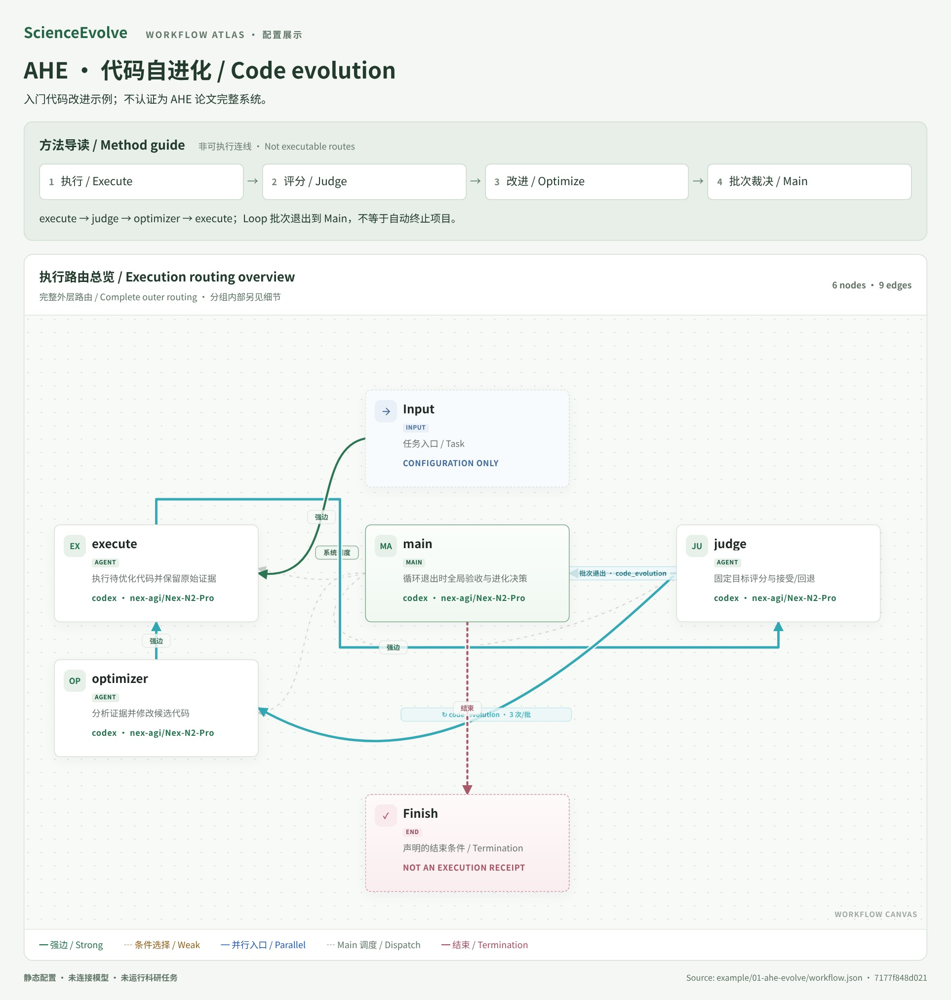

# AHE · 代码自进化 / Code evolution

[← 画廊 / Gallery](README.md) · [English index](README_en.md) · [Workflow JSON](../../../example/01-ahe-evolve/workflow.json)

## 方法与边界 / Method and scope

入门代码改进示例；不认证为 AHE 论文完整系统。

> **方法顺序，不是执行路由 / Method guide, not executable routes**
>
> 执行 / Execute → 评分 / Judge → 改进 / Optimize → 批次裁决 / Main

execute → judge → optimizer → execute；Loop 批次退出到 Main，不等于自动终止项目。

[原始依据 / Source](../../../example/01-ahe-evolve/workflow.json) · [方法映射 / Method mapping](../../../example/METHODS.md#01-ahe-evolve)

## 执行路由 / Execution routing

真实前端 CanvasWorld / CanvasNodes / CanvasEdges 的文档展示；单独配置展示坐标和可读字号，不改 JSON 路由。不是完整应用界面截图。静态配置，未连接模型或执行科研任务。

[完整图片 / Full image](01-ahe-evolve.jpg) · [来源和截图校验 / Manifest](manifest.json)
