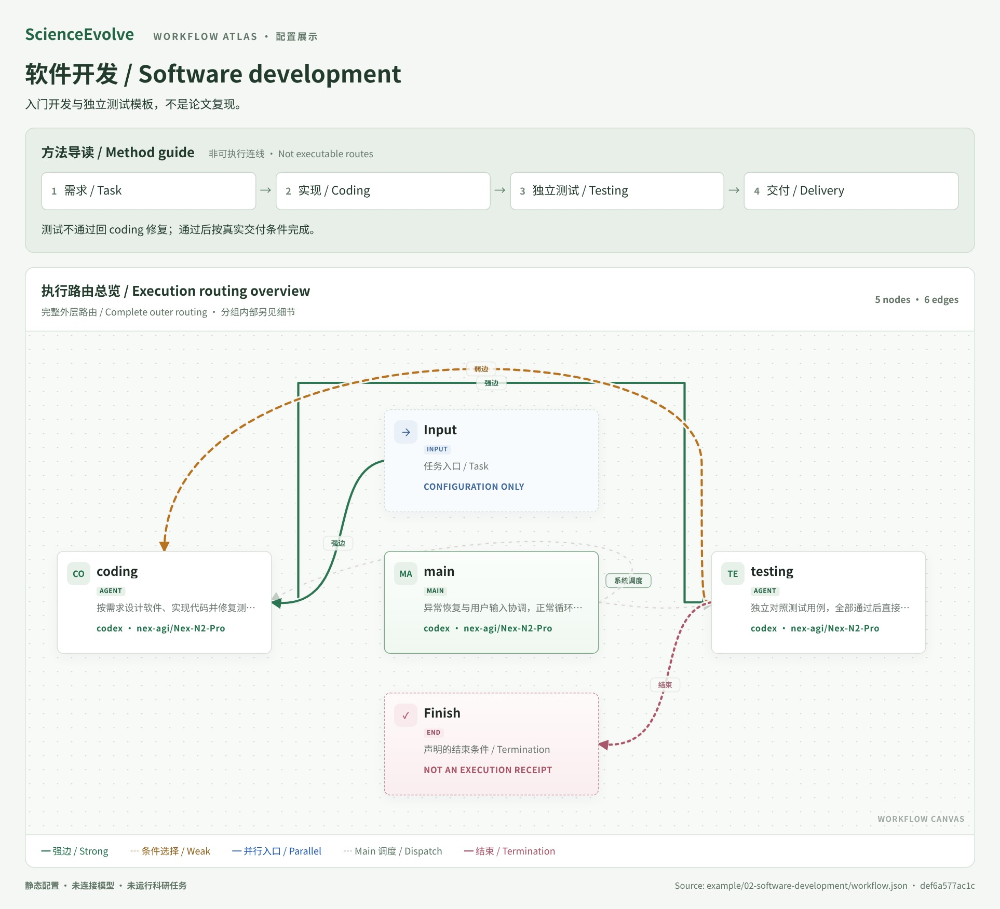

# 软件开发 / Software development

[← 画廊 / Gallery](README.md) · [English index](README_en.md) · [Workflow JSON](../../../example/02-software-development/workflow.json)

## 方法与边界 / Method and scope

入门开发与独立测试模板，不是论文复现。

> **方法顺序，不是执行路由 / Method guide, not executable routes**
>
> 需求 / Task → 实现 / Coding → 独立测试 / Testing → 交付 / Delivery

测试不通过回 coding 修复；通过后按真实交付条件完成。

[原始依据 / Source](../../../example/02-software-development/workflow.json) · [方法映射 / Method mapping](../../../example/METHODS.md#02-software-development)

## 执行路由 / Execution routing

真实前端 CanvasWorld / CanvasNodes / CanvasEdges 的文档展示；单独配置展示坐标和可读字号，不改 JSON 路由。不是完整应用界面截图。静态配置，未连接模型或执行科研任务。

[完整图片 / Full image](02-software-development.jpg) · [来源和截图校验 / Manifest](manifest.json)
