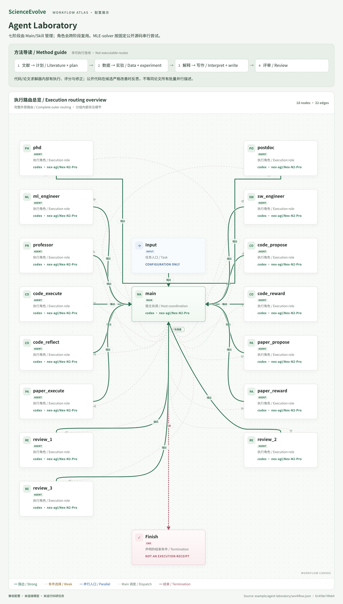
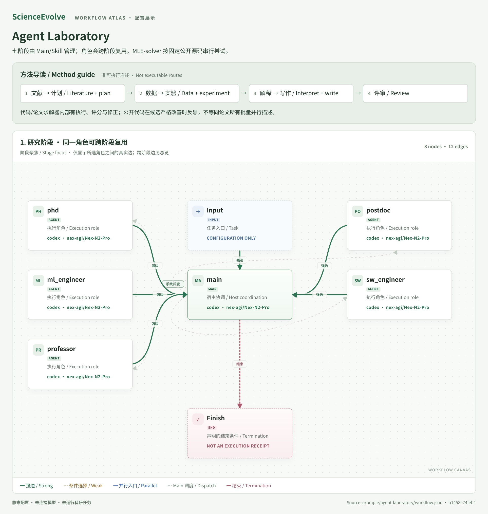
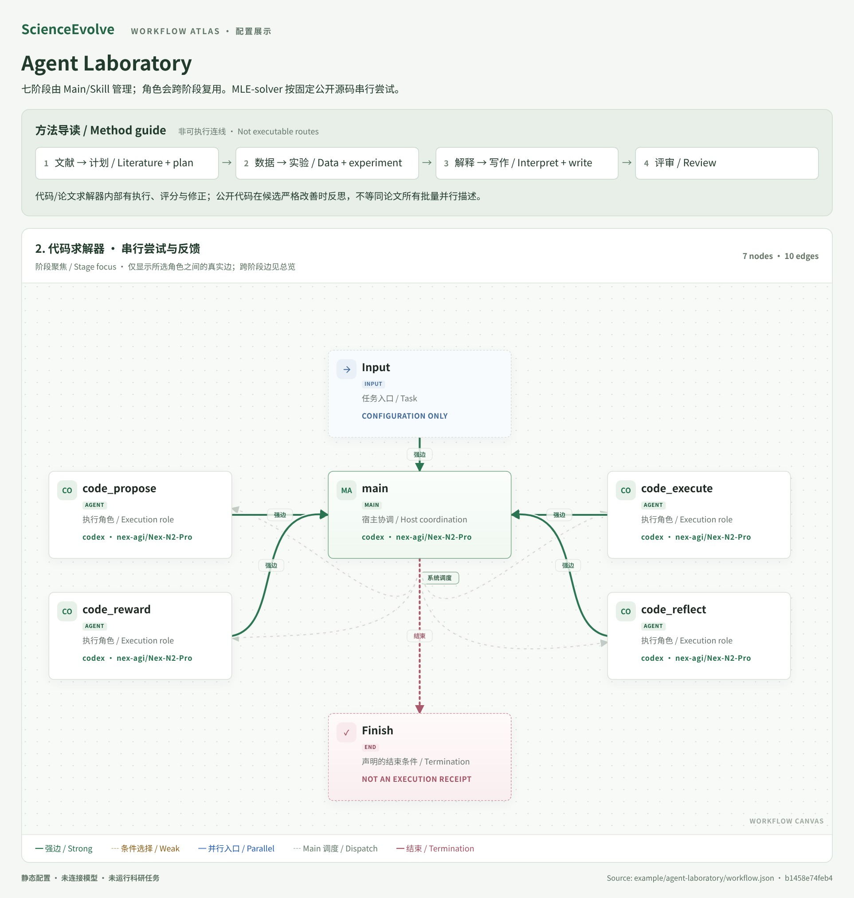
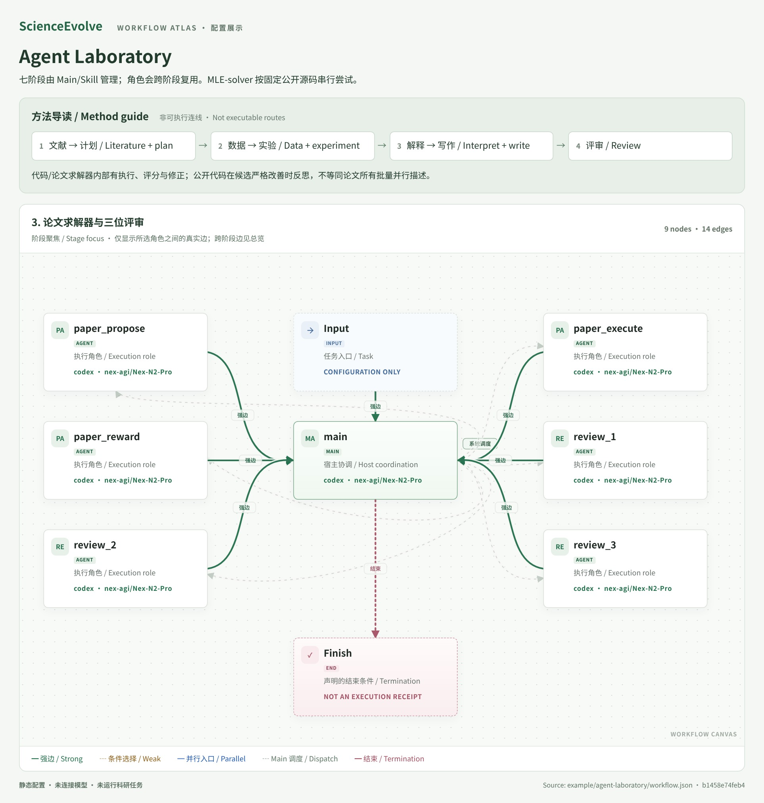

# Agent Laboratory

[← 画廊 / Gallery](README.md) · [English index](README_en.md) · [Workflow JSON](../../../example/agent-laboratory/workflow.json)

## 方法与边界 / Method and scope

七阶段由 Main/Skill 管理；角色会跨阶段复用。MLE-solver 按固定公开源码串行尝试。

> **方法顺序，不是执行路由 / Method guide, not executable routes**
>
> 文献 → 计划 / Literature + plan → 数据 → 实验 / Data + experiment → 解释 → 写作 / Interpret + write → 评审 / Review

代码/论文求解器内部有执行、评分与修正；公开代码在候选严格改善时反思，不等同论文所有批量并行描述。

[原始依据 / Source](https://arxiv.org/html/2501.04227v1) · [方法映射 / Method mapping](../../../example/METHODS.md#agent-laboratory)

## 执行路由 / Execution routing

真实前端 CanvasWorld / CanvasNodes / CanvasEdges 的文档展示；单独配置展示坐标和可读字号，不改 JSON 路由。不是完整应用界面截图。静态配置，未连接模型或执行科研任务。

先读下方阶段／组内细节；总览用于核对全图。阶段图只显示所选角色之间的真实边，跨阶段边见总览。

展开完整路由总览 / Full routing overview

## 可读细节 / Readable details

### 1. 研究阶段 · 同一角色可跨阶段复用

[打开原图 / Open image](agent-laboratory--stage-1.jpg)

### 2. 代码求解器 · 串行尝试与反馈

[打开原图 / Open image](agent-laboratory--stage-2.jpg)

### 3. 论文求解器与三位评审

[打开原图 / Open image](agent-laboratory--stage-3.jpg)

[完整图片 / Full image](agent-laboratory.jpg) · [来源和截图校验 / Manifest](manifest.json)
