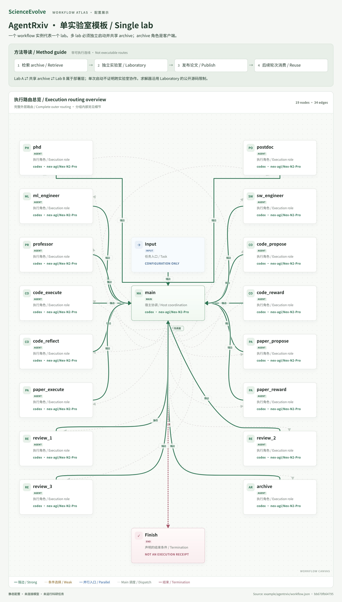
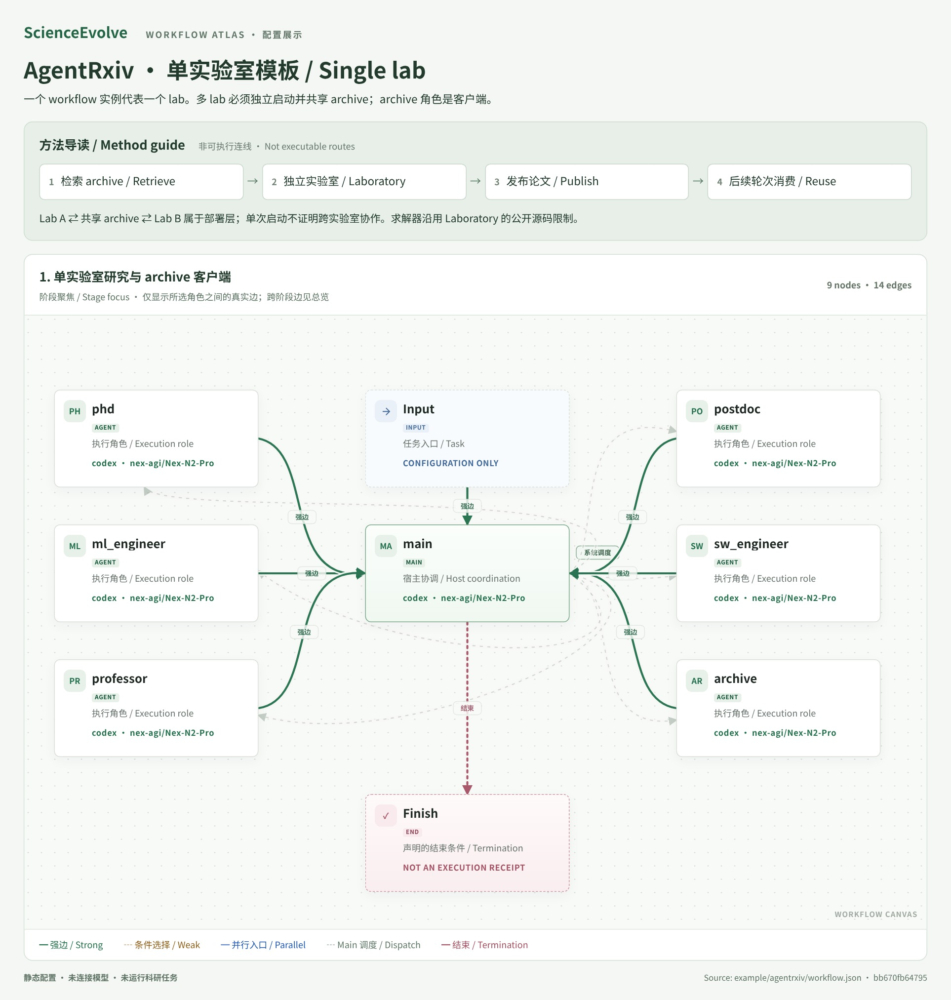
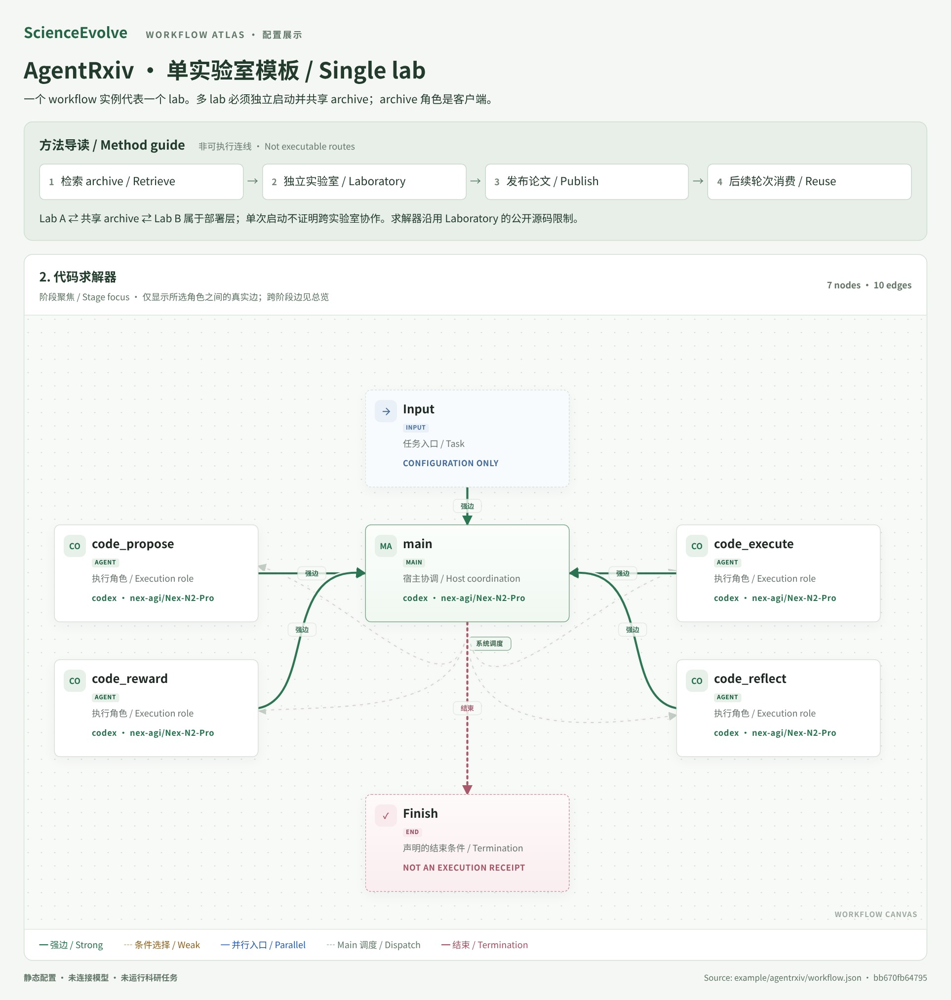
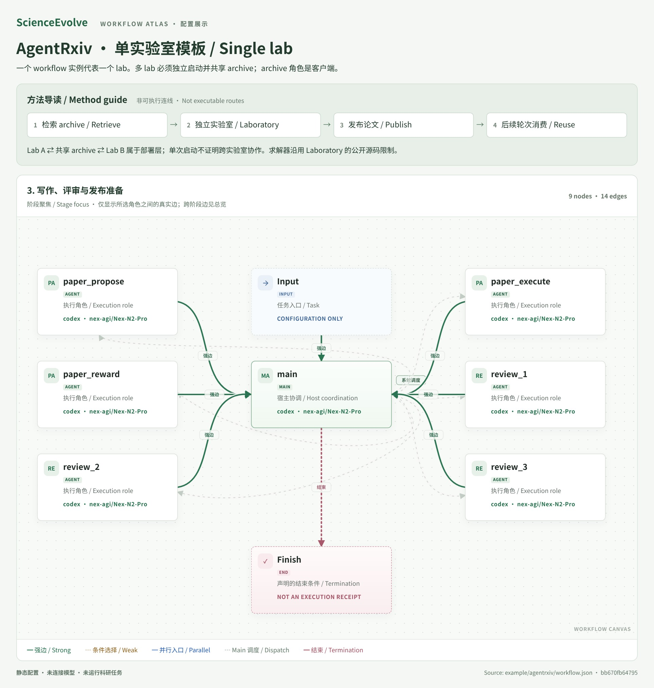

# AgentRxiv · 单实验室模板 / Single lab

[← 画廊 / Gallery](README.md) · [English index](README_en.md) · [Workflow JSON](../../../example/agentrxiv/workflow.json)

## 方法与边界 / Method and scope

一个 workflow 实例代表一个 lab。多 lab 必须独立启动并共享 archive；archive 角色是客户端。

> **方法顺序，不是执行路由 / Method guide, not executable routes**
>
> 检索 archive / Retrieve → 独立实验室 / Laboratory → 发布论文 / Publish → 后续轮次消费 / Reuse

Lab A ⇄ 共享 archive ⇄ Lab B 属于部署层；单次启动不证明跨实验室协作。求解器沿用 Laboratory 的公开源码限制。

[原始依据 / Source](https://arxiv.org/html/2503.18102v1) · [方法映射 / Method mapping](../../../example/METHODS.md#agentrxiv)

## 执行路由 / Execution routing

真实前端 CanvasWorld / CanvasNodes / CanvasEdges 的文档展示；单独配置展示坐标和可读字号，不改 JSON 路由。不是完整应用界面截图。静态配置，未连接模型或执行科研任务。

先读下方阶段／组内细节；总览用于核对全图。阶段图只显示所选角色之间的真实边，跨阶段边见总览。

展开完整路由总览 / Full routing overview

## 可读细节 / Readable details

### 1. 单实验室研究与 archive 客户端

[打开原图 / Open image](agentrxiv--stage-1.jpg)

### 2. 代码求解器

[打开原图 / Open image](agentrxiv--stage-2.jpg)

### 3. 写作、评审与发布准备

[打开原图 / Open image](agentrxiv--stage-3.jpg)

[完整图片 / Full image](agentrxiv.jpg) · [来源和截图校验 / Manifest](manifest.json)
