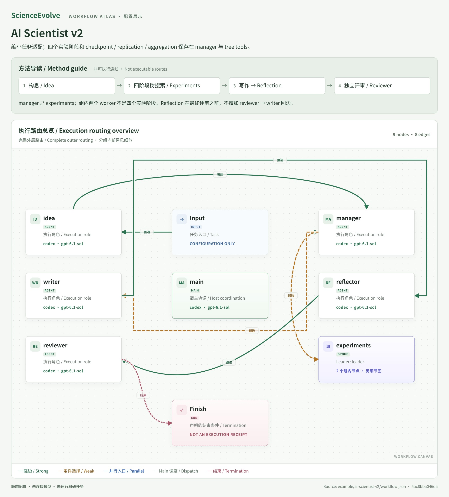
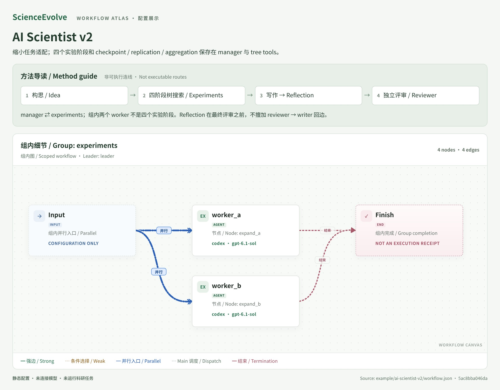

# AI Scientist v2

[← 画廊 / Gallery](README.md) · [English index](README_en.md) · [Workflow JSON](../../../example/ai-scientist-v2/workflow.json)

## 方法与边界 / Method and scope

缩小任务适配；四个实验阶段和 checkpoint / replication / aggregation 保存在 manager 与 tree tools。

> **方法顺序，不是执行路由 / Method guide, not executable routes**
>
> 构思 / Idea → 四阶段树搜索 / Experiments → 写作 → Reflection → 独立评审 / Reviewer

manager ⇄ experiments；组内两个 worker 不是四个实验阶段。Reflection 在最终评审之前，不擅加 reviewer → writer 回边。

[原始依据 / Source](https://arxiv.org/html/2504.08066v1) · [方法映射 / Method mapping](../../../example/METHODS.md#ai-scientist-v2)

## 执行路由 / Execution routing

真实前端 CanvasWorld / CanvasNodes / CanvasEdges 的文档展示；单独配置展示坐标和可读字号，不改 JSON 路由。不是完整应用界面截图。静态配置，未连接模型或执行科研任务。

先读下方阶段／组内细节；总览用于核对全图。阶段图只显示所选角色之间的真实边，跨阶段边见总览。

展开完整路由总览 / Full routing overview

## 可读细节 / Readable details

### 组内细节 / Group: experiments

[打开原图 / Open image](ai-scientist-v2--group-experiments.jpg)

[完整图片 / Full image](ai-scientist-v2.jpg) · [来源和截图校验 / Manifest](manifest.json)
