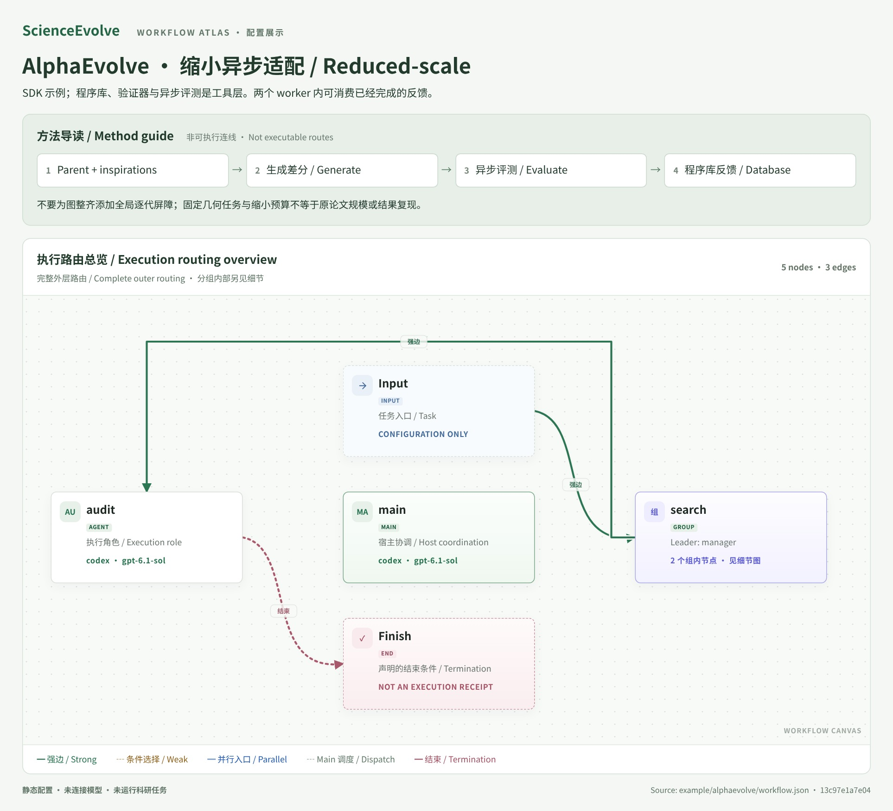
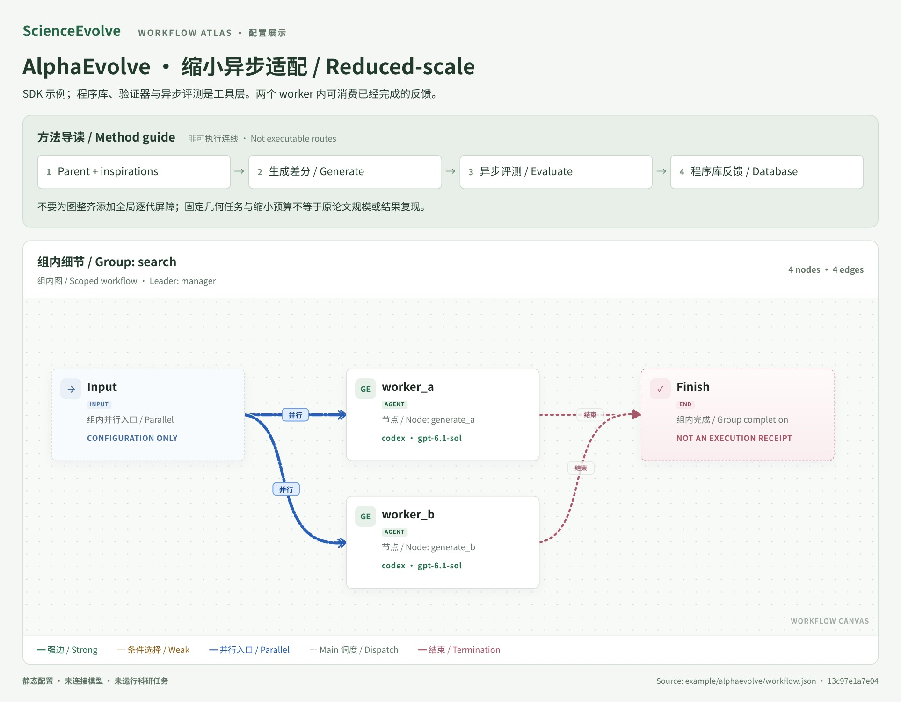

# AlphaEvolve · 缩小异步适配 / Reduced-scale

[← 画廊 / Gallery](README.md) · [English index](README_en.md) · [Workflow JSON](../../../example/alphaevolve/workflow.json)

## 方法与边界 / Method and scope

SDK 示例；程序库、验证器与异步评测是工具层。两个 worker 内可消费已经完成的反馈。

> **方法顺序，不是执行路由 / Method guide, not executable routes**
>
> Parent + inspirations → 生成差分 / Generate → 异步评测 / Evaluate → 程序库反馈 / Database

不要为图整齐添加全局逐代屏障；固定几何任务与缩小预算不等于原论文规模或结果复现。

[原始依据 / Source](https://arxiv.org/html/2506.13131v1) · [方法映射 / Method mapping](../../../example/METHODS.md#alphaevolve)

## 执行路由 / Execution routing

真实前端 CanvasWorld / CanvasNodes / CanvasEdges 的文档展示；单独配置展示坐标和可读字号，不改 JSON 路由。不是完整应用界面截图。静态配置，未连接模型或执行科研任务。

先读下方阶段／组内细节；总览用于核对全图。阶段图只显示所选角色之间的真实边，跨阶段边见总览。

展开完整路由总览 / Full routing overview

## 可读细节 / Readable details

### 组内细节 / Group: search

[打开原图 / Open image](alphaevolve--group-search.jpg)

[完整图片 / Full image](alphaevolve.jpg) · [来源和截图校验 / Manifest](manifest.json)
