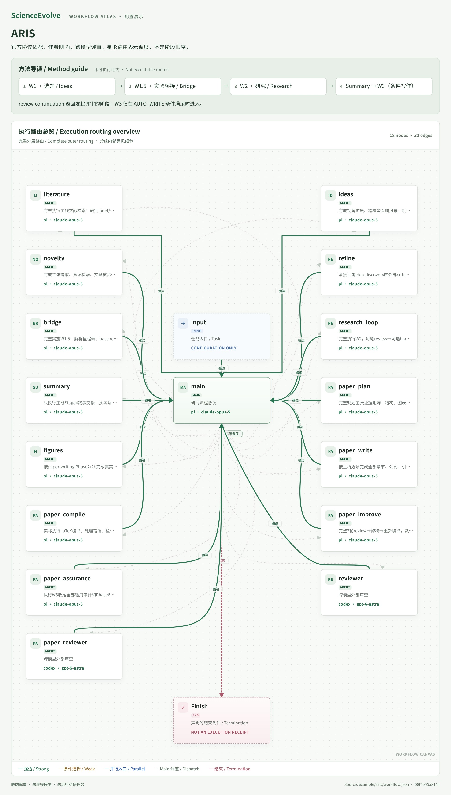
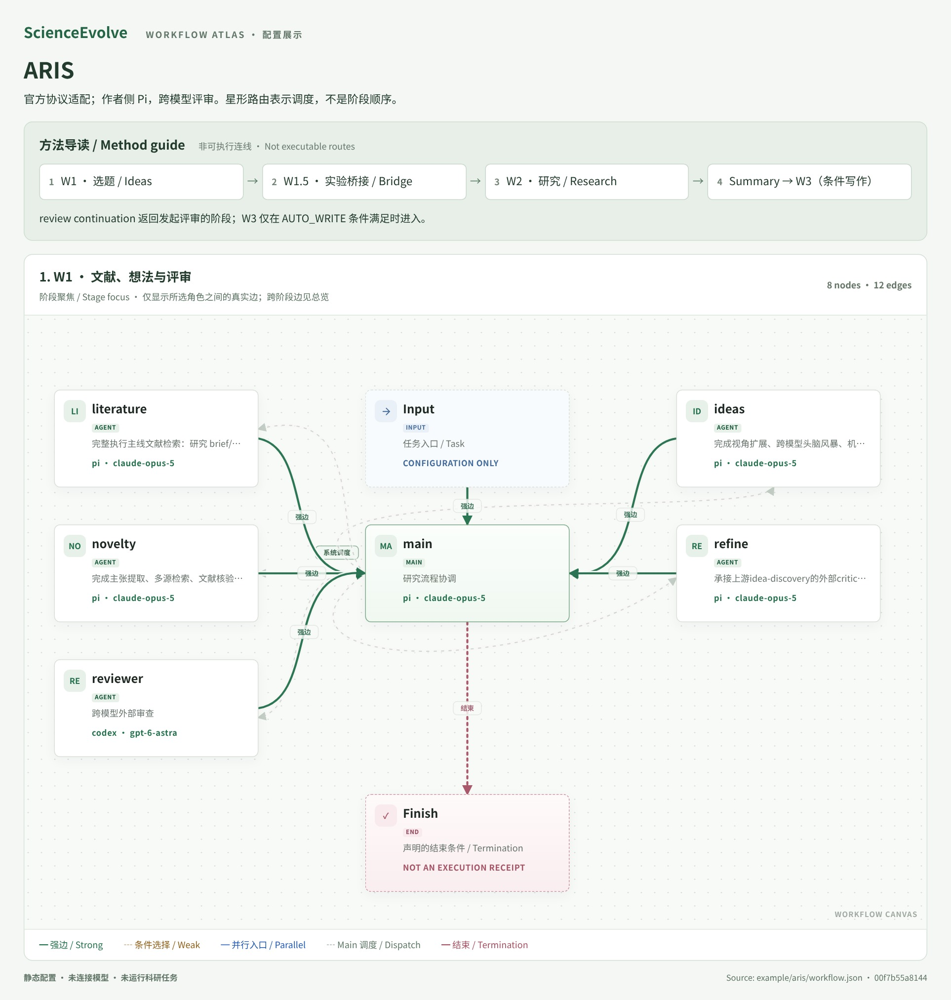
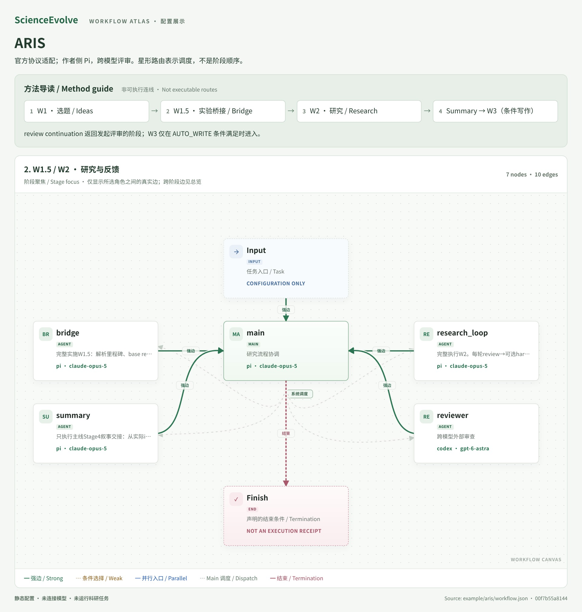
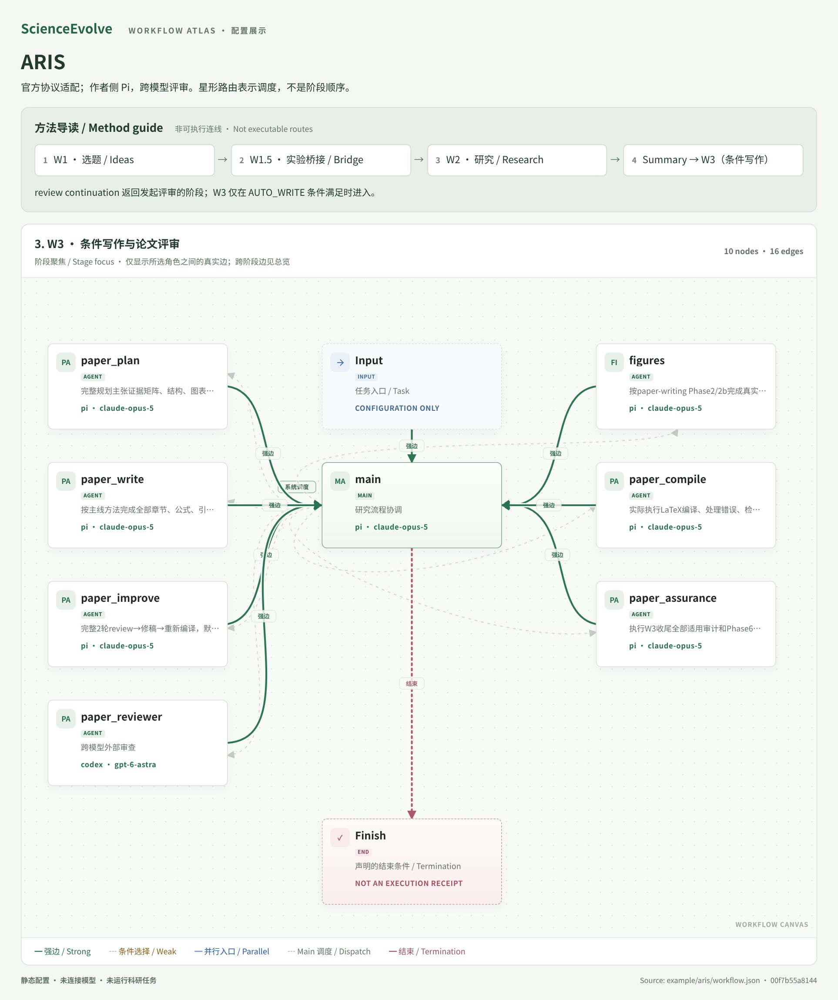

# ARIS

[← 画廊 / Gallery](README.md) · [English index](README_en.md) · [Workflow JSON](../../../example/aris/workflow.json)

## 方法与边界 / Method and scope

官方协议适配；作者侧 Pi，跨模型评审。星形路由表示调度，不是阶段顺序。

> **方法顺序，不是执行路由 / Method guide, not executable routes**
>
> W1 · 选题 / Ideas → W1.5 · 实验桥接 / Bridge → W2 · 研究 / Research → Summary → W3（条件写作）

review continuation 返回发起评审的阶段；W3 仅在 AUTO_WRITE 条件满足时进入。

[原始依据 / Source](https://github.com/wanshuiyin/Auto-claude-code-research-in-sleep/blob/341f914024d270dc5c8fa51337d1ad38829273aa/skills/research-pipeline/SKILL.md) · [方法映射 / Method mapping](../../../example/METHODS.md#aris)

## 执行路由 / Execution routing

真实前端 CanvasWorld / CanvasNodes / CanvasEdges 的文档展示；单独配置展示坐标和可读字号，不改 JSON 路由。不是完整应用界面截图。静态配置，未连接模型或执行科研任务。

先读下方阶段／组内细节；总览用于核对全图。阶段图只显示所选角色之间的真实边，跨阶段边见总览。

展开完整路由总览 / Full routing overview

## 可读细节 / Readable details

### 1. W1 · 文献、想法与评审

[打开原图 / Open image](aris--stage-1.jpg)

### 2. W1.5 / W2 · 研究与反馈

[打开原图 / Open image](aris--stage-2.jpg)

### 3. W3 · 条件写作与论文评审

[打开原图 / Open image](aris--stage-3.jpg)

[完整图片 / Full image](aris.jpg) · [来源和截图校验 / Manifest](manifest.json)
