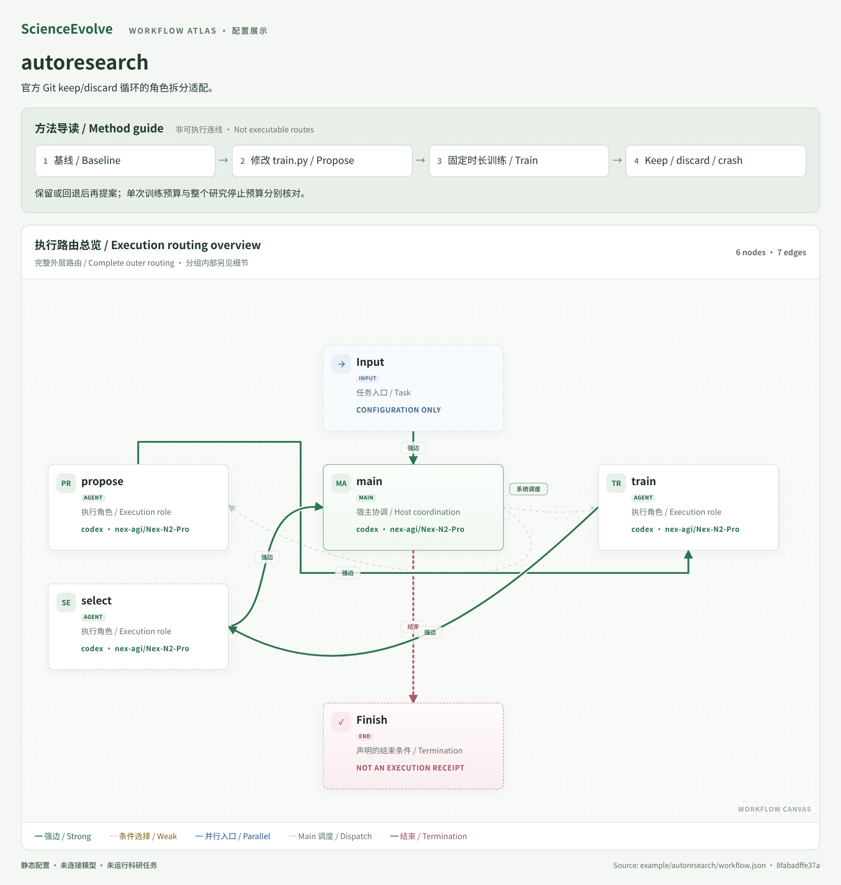

# autoresearch

[← 画廊 / Gallery](README.md) · [English index](README_en.md) · [Workflow JSON](../../../example/autoresearch/workflow.json)

## 方法与边界 / Method and scope

官方 Git keep/discard 循环的角色拆分适配。

> **方法顺序，不是执行路由 / Method guide, not executable routes**
>
> 基线 / Baseline → 修改 train.py / Propose → 固定时长训练 / Train → Keep / discard / crash

保留或回退后再提案；单次训练预算与整个研究停止预算分别核对。

[原始依据 / Source](https://github.com/karpathy/autoresearch/blob/228791fb499afffb54b46200aca536f79142f117/program.md) · [方法映射 / Method mapping](../../../example/METHODS.md#autoresearch)

## 执行路由 / Execution routing

真实前端 CanvasWorld / CanvasNodes / CanvasEdges 的文档展示；单独配置展示坐标和可读字号，不改 JSON 路由。不是完整应用界面截图。静态配置，未连接模型或执行科研任务。

[完整图片 / Full image](autoresearch.jpg) · [来源和截图校验 / Manifest](manifest.json)
