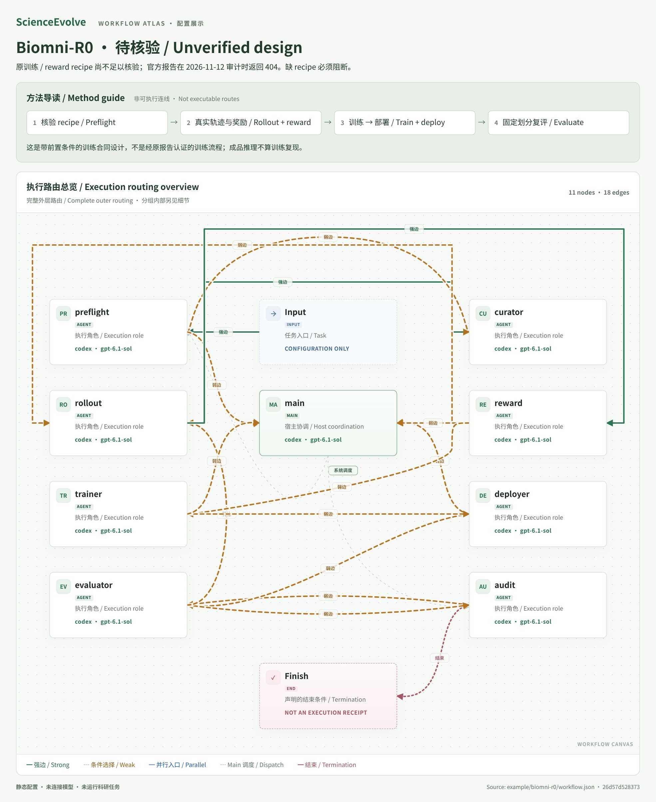

# Biomni-R0 · 待核验 / Unverified design

[← 画廊 / Gallery](README.md) · [English index](README_en.md) · [Workflow JSON](../../../example/biomni-r0/workflow.json)

## 方法与边界 / Method and scope

原训练 / reward recipe 尚不足以核验；官方报告在 2026-11-12 审计时返回 404。缺 recipe 必须阻断。

> **方法顺序，不是执行路由 / Method guide, not executable routes**
>
> 核验 recipe / Preflight → 真实轨迹与奖励 / Rollout + reward → 训练 → 部署 / Train + deploy → 固定划分复评 / Evaluate

这是带前置条件的训练合同设计，不是经原报告认证的训练流程；成品推理不算训练复现。

[原始依据 / Source](https://huggingface.co/biomni/Biomni-R0-32B-Preview) · [方法映射 / Method mapping](../../../example/METHODS.md#biomni-r0)

## 执行路由 / Execution routing

真实前端 CanvasWorld / CanvasNodes / CanvasEdges 的文档展示；单独配置展示坐标和可读字号，不改 JSON 路由。不是完整应用界面截图。静态配置，未连接模型或执行科研任务。

[完整图片 / Full image](biomni-r0.jpg) · [来源和截图校验 / Manifest](manifest.json)
