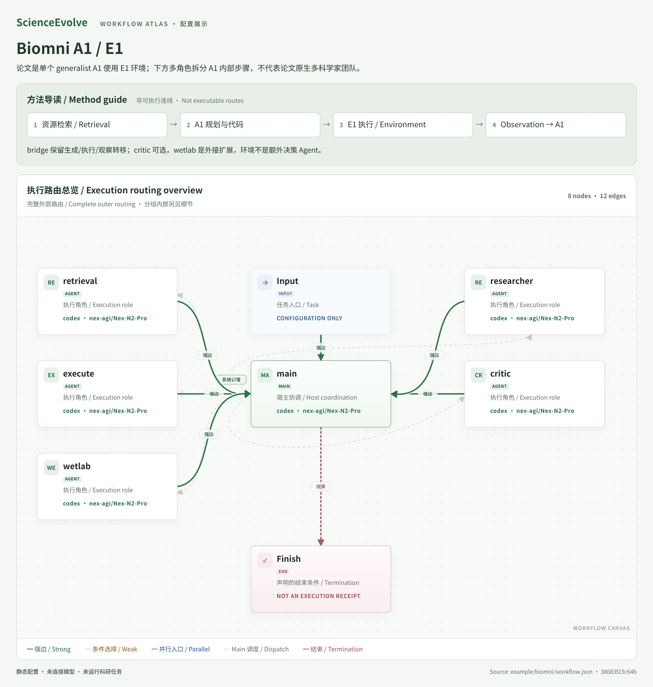

# Biomni A1 / E1

[← 画廊 / Gallery](README.md) · [English index](README_en.md) · [Workflow JSON](../../../example/biomni/workflow.json)

## 方法与边界 / Method and scope

论文是单个 generalist A1 使用 E1 环境；下方多角色拆分 A1 内部步骤，不代表论文原生多科学家团队。

> **方法顺序，不是执行路由 / Method guide, not executable routes**
>
> 资源检索 / Retrieval → A1 规划与代码 → E1 执行 / Environment → Observation → A1

bridge 保留生成/执行/观察转移；critic 可选，wetlab 是外接扩展，环境不是额外决策 Agent。

[原始依据 / Source](https://www.biorxiv.org/content/10.1101/2025.05.30.656746v1.full) · [方法映射 / Method mapping](../../../example/METHODS.md#biomni)

## 执行路由 / Execution routing

真实前端 CanvasWorld / CanvasNodes / CanvasEdges 的文档展示；单独配置展示坐标和可读字号，不改 JSON 路由。不是完整应用界面截图。静态配置，未连接模型或执行科研任务。

[完整图片 / Full image](biomni.jpg) · [来源和截图校验 / Manifest](manifest.json)
