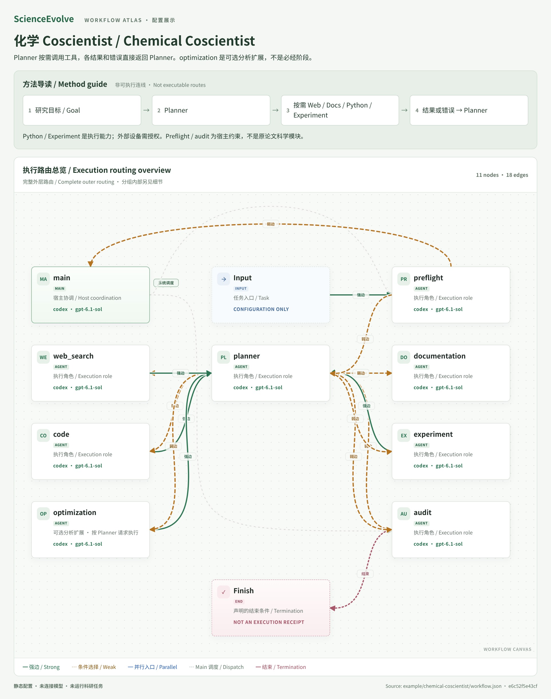

# 化学 Coscientist / Chemical Coscientist

[← 画廊 / Gallery](README.md) · [English index](README_en.md) · [Workflow JSON](../../../example/chemical-coscientist/workflow.json)

## 方法与边界 / Method and scope

Planner 按需调用工具，各结果和错误直接返回 Planner。optimization 是可选分析扩展，不是必经阶段。

> **方法顺序，不是执行路由 / Method guide, not executable routes**
>
> 研究目标 / Goal → Planner → 按需 Web / Docs / Python / Experiment → 结果或错误 → Planner

Python / Experiment 是执行能力；外部设备需授权。Preflight / audit 为宿主约束，不是原论文科学模块。

[原始依据 / Source](https://www.nature.com/articles/s41586-023-06792-0) · [方法映射 / Method mapping](../../../example/METHODS.md#chemical-coscientist)

## 执行路由 / Execution routing

真实前端 CanvasWorld / CanvasNodes / CanvasEdges 的文档展示；单独配置展示坐标和可读字号，不改 JSON 路由。不是完整应用界面截图。静态配置，未连接模型或执行科研任务。

[完整图片 / Full image](chemical-coscientist.jpg) · [来源和截图校验 / Manifest](manifest.json)
