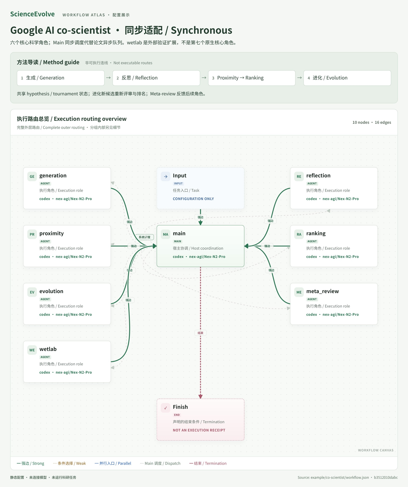
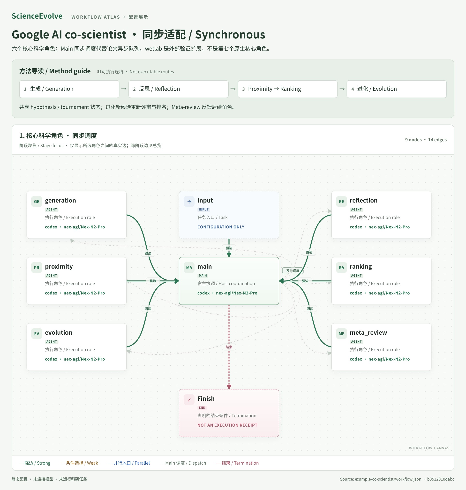
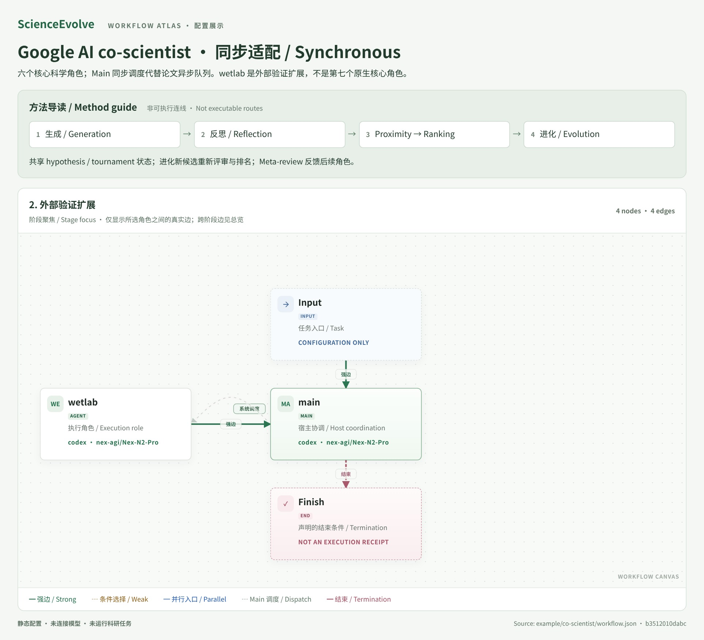

# Google AI co-scientist · 同步适配 / Synchronous

[← 画廊 / Gallery](README.md) · [English index](README_en.md) · [Workflow JSON](../../../example/co-scientist/workflow.json)

## 方法与边界 / Method and scope

六个核心科学角色；Main 同步调度代替论文异步队列。wetlab 是外部验证扩展，不是第七个原生核心角色。

> **方法顺序，不是执行路由 / Method guide, not executable routes**
>
> 生成 / Generation → 反思 / Reflection → Proximity → Ranking → 进化 / Evolution

共享 hypothesis / tournament 状态；进化新候选重新评审与排名；Meta-review 反馈后续角色。

[原始依据 / Source](https://arxiv.org/html/2502.18864v1) · [方法映射 / Method mapping](../../../example/METHODS.md#co-scientist)

## 执行路由 / Execution routing

真实前端 CanvasWorld / CanvasNodes / CanvasEdges 的文档展示；单独配置展示坐标和可读字号，不改 JSON 路由。不是完整应用界面截图。静态配置，未连接模型或执行科研任务。

先读下方阶段／组内细节；总览用于核对全图。阶段图只显示所选角色之间的真实边，跨阶段边见总览。

展开完整路由总览 / Full routing overview

## 可读细节 / Readable details

### 1. 核心科学角色 · 同步调度

[打开原图 / Open image](co-scientist--stage-1.jpg)

### 2. 外部验证扩展

[打开原图 / Open image](co-scientist--stage-2.jpg)

[完整图片 / Full image](co-scientist.jpg) · [来源和截图校验 / Manifest](manifest.json)
