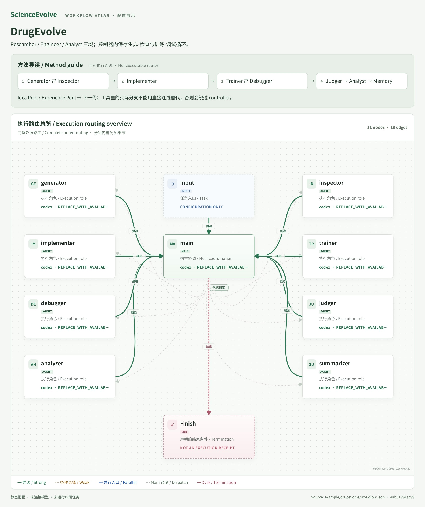
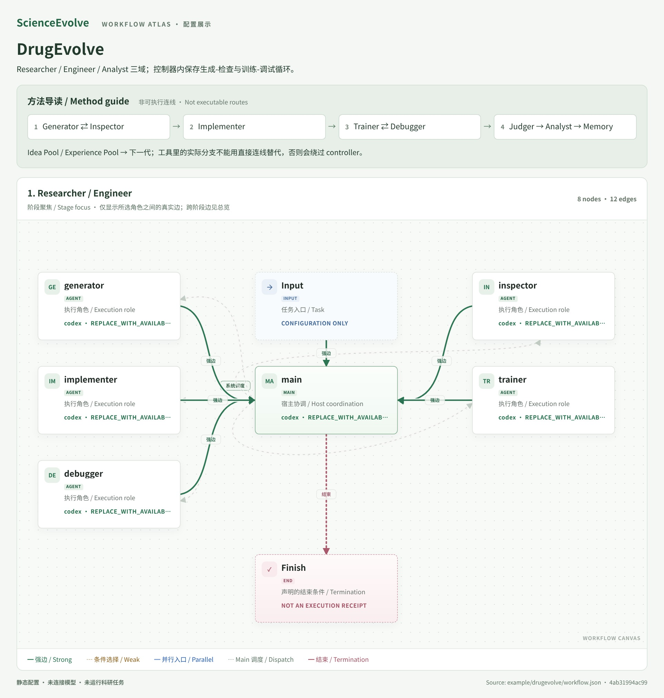
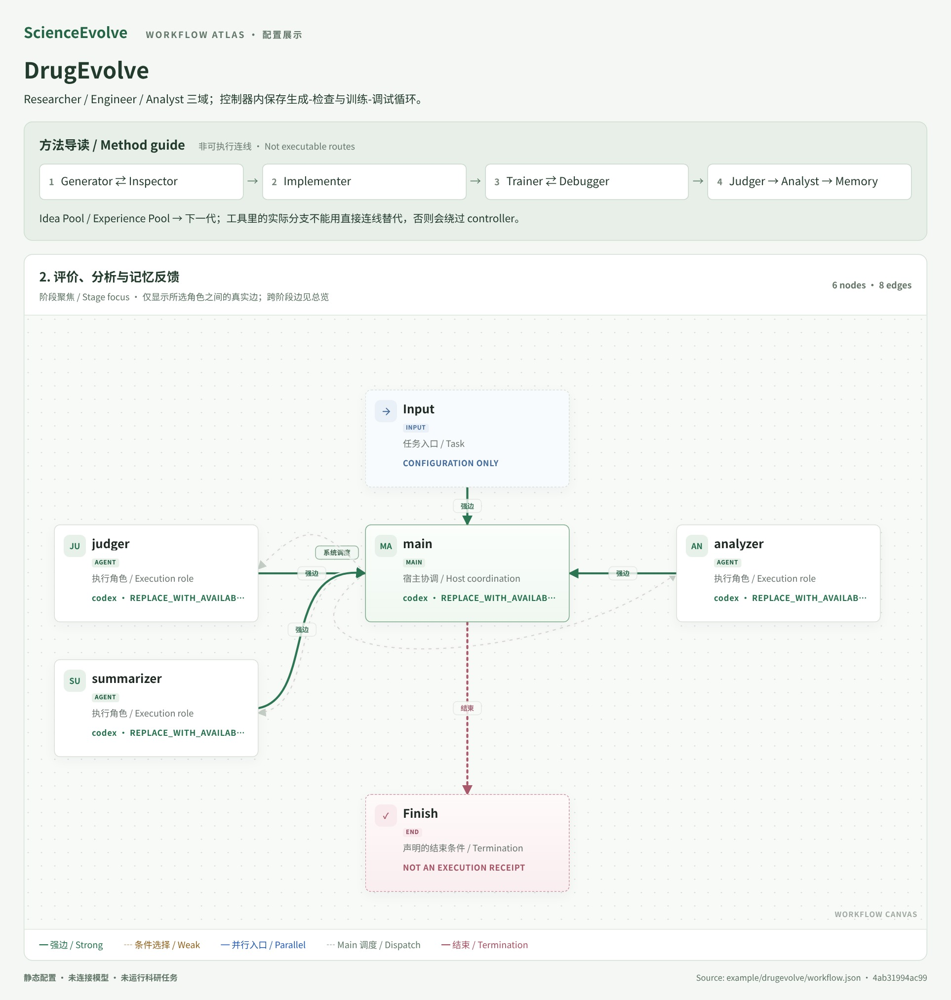

# DrugEvolve

[← 画廊 / Gallery](README.md) · [English index](README_en.md) · [Workflow JSON](../../../example/drugevolve/workflow.json)

## 方法与边界 / Method and scope

Researcher / Engineer / Analyst 三域；控制器内保存生成-检查与训练-调试循环。

> **方法顺序，不是执行路由 / Method guide, not executable routes**
>
> Generator ⇄ Inspector → Implementer → Trainer ⇄ Debugger → Judger → Analyst → Memory

Idea Pool / Experience Pool → 下一代；工具里的实际分支不能用直接连线替代，否则会绕过 controller。

[原始依据 / Source](https://www.biorxiv.org/content/10.64898/2026.08.16.745117v1.full) · [方法映射 / Method mapping](../../../example/METHODS.md#drugevolve)

## 执行路由 / Execution routing

真实前端 CanvasWorld / CanvasNodes / CanvasEdges 的文档展示；单独配置展示坐标和可读字号，不改 JSON 路由。不是完整应用界面截图。静态配置，未连接模型或执行科研任务。

先读下方阶段／组内细节；总览用于核对全图。阶段图只显示所选角色之间的真实边，跨阶段边见总览。

展开完整路由总览 / Full routing overview

## 可读细节 / Readable details

### 1. Researcher / Engineer

[打开原图 / Open image](drugevolve--stage-1.jpg)

### 2. 评价、分析与记忆反馈

[打开原图 / Open image](drugevolve--stage-2.jpg)

[完整图片 / Full image](drugevolve.jpg) · [来源和截图校验 / Manifest](manifest.json)
