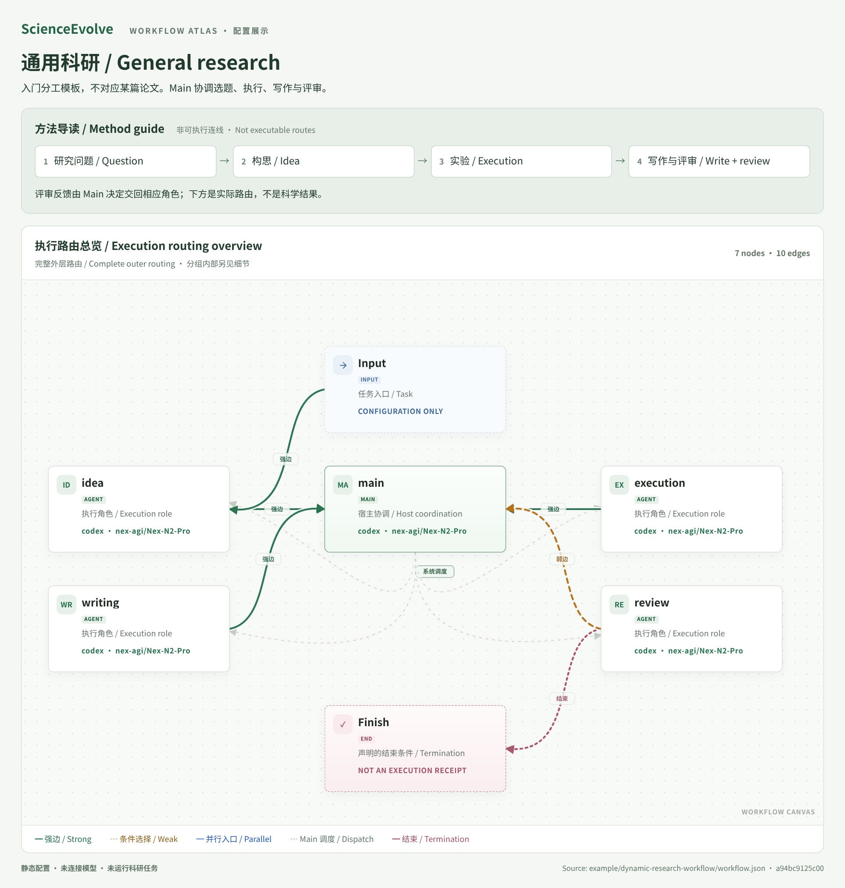

# 通用科研 / General research

[← 画廊 / Gallery](README.md) · [English index](README_en.md) · [Workflow JSON](../../../example/dynamic-research-workflow/workflow.json)

## 方法与边界 / Method and scope

入门分工模板，不对应某篇论文。Main 协调选题、执行、写作与评审。

> **方法顺序，不是执行路由 / Method guide, not executable routes**
>
> 研究问题 / Question → 构思 / Idea → 实验 / Execution → 写作与评审 / Write + review

评审反馈由 Main 决定交回相应角色；下方是实际路由，不是科学结果。

[原始依据 / Source](../../../example/dynamic-research-workflow/workflow.json) · [方法映射 / Method mapping](../../../example/METHODS.md#dynamic-research-workflow)

## 执行路由 / Execution routing

真实前端 CanvasWorld / CanvasNodes / CanvasEdges 的文档展示；单独配置展示坐标和可读字号，不改 JSON 路由。不是完整应用界面截图。静态配置，未连接模型或执行科研任务。

[完整图片 / Full image](dynamic-research-workflow.jpg) · [来源和截图校验 / Manifest](manifest.json)
