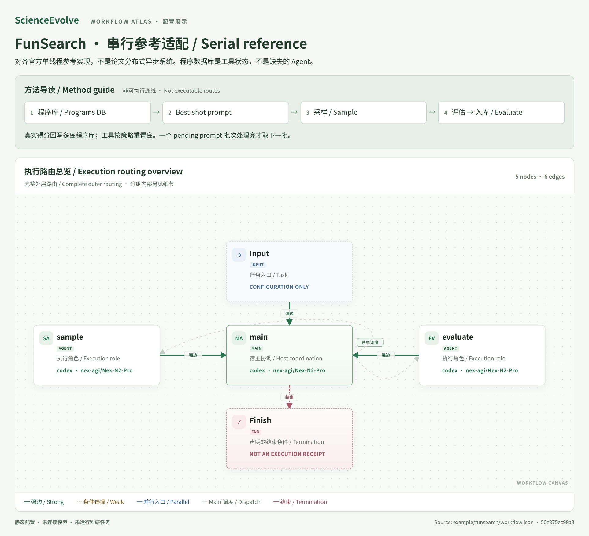

# FunSearch · 串行参考适配 / Serial reference

[← 画廊 / Gallery](README.md) · [English index](README_en.md) · [Workflow JSON](../../../example/funsearch/workflow.json)

## 方法与边界 / Method and scope

对齐官方单线程参考实现，不是论文分布式异步系统。程序数据库是工具状态，不是缺失的 Agent。

> **方法顺序，不是执行路由 / Method guide, not executable routes**
>
> 程序库 / Programs DB → Best-shot prompt → 采样 / Sample → 评估 → 入库 / Evaluate

真实得分回写多岛程序库；工具按策略重置岛。一个 pending prompt 批次处理完才取下一批。

[原始依据 / Source](https://www.nature.com/articles/s41586-023-06924-6) · [方法映射 / Method mapping](../../../example/METHODS.md#funsearch)

## 执行路由 / Execution routing

真实前端 CanvasWorld / CanvasNodes / CanvasEdges 的文档展示；单独配置展示坐标和可读字号，不改 JSON 路由。不是完整应用界面截图。静态配置，未连接模型或执行科研任务。

[完整图片 / Full image](funsearch.jpg) · [来源和截图校验 / Manifest](manifest.json)
