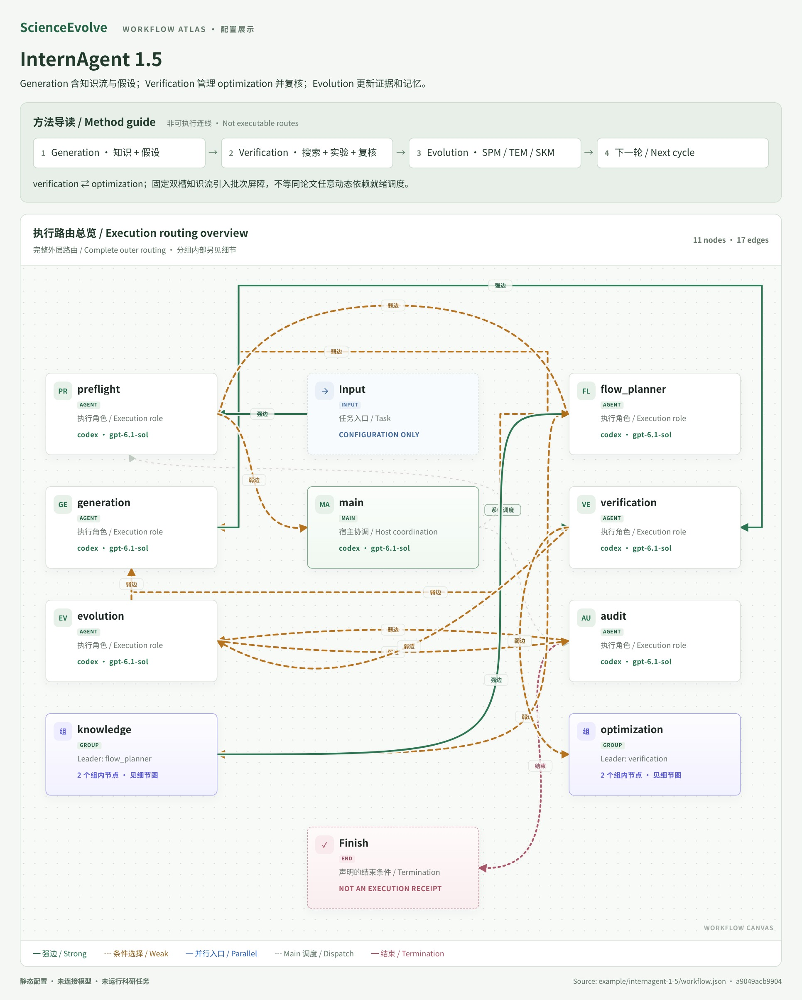
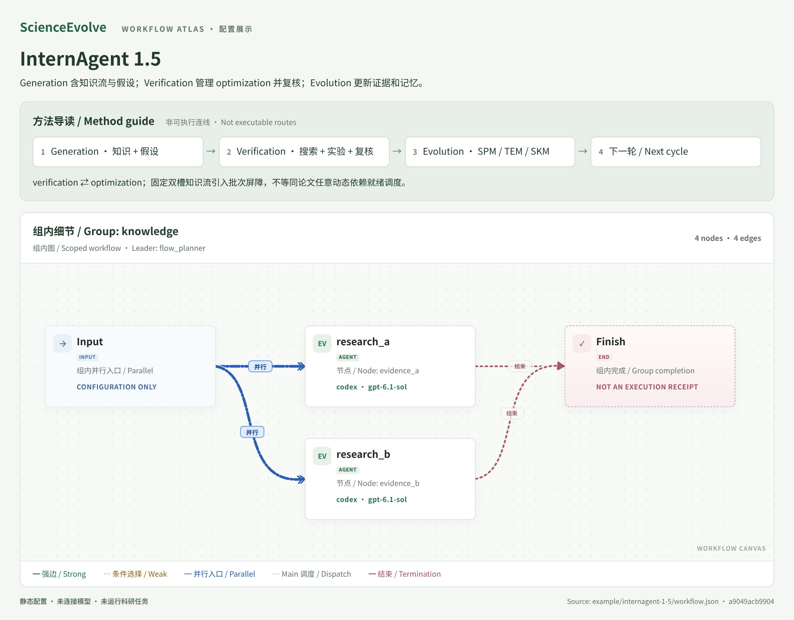
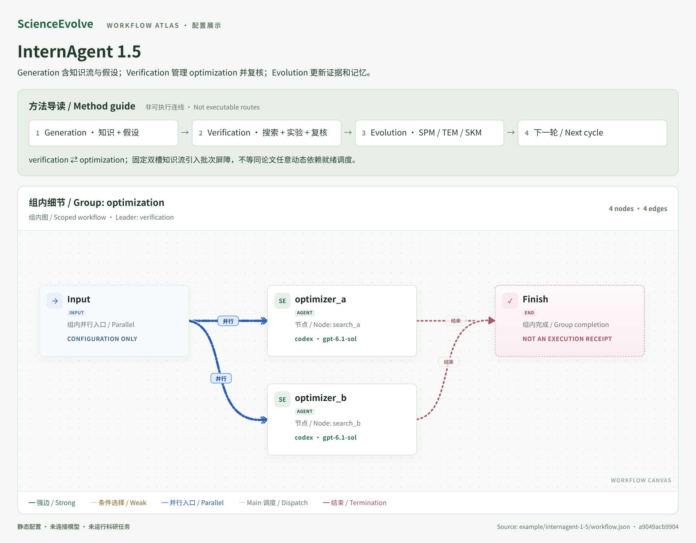

# InternAgent 1.5

[← 画廊 / Gallery](README.md) · [English index](README_en.md) · [Workflow JSON](../../../example/internagent-1-5/workflow.json)

## 方法与边界 / Method and scope

Generation 含知识流与假设；Verification 管理 optimization 并复核；Evolution 更新证据和记忆。

> **方法顺序，不是执行路由 / Method guide, not executable routes**
>
> Generation · 知识 + 假设 → Verification · 搜索 + 实验 + 复核 → Evolution · SPM / TEM / SKM → 下一轮 / Next cycle

verification ⇄ optimization；固定双槽知识流引入批次屏障，不等同论文任意动态依赖就绪调度。

[原始依据 / Source](https://arxiv.org/html/2602.08990v1) · [方法映射 / Method mapping](../../../example/METHODS.md#internagent-1-5)

## 执行路由 / Execution routing

真实前端 CanvasWorld / CanvasNodes / CanvasEdges 的文档展示；单独配置展示坐标和可读字号，不改 JSON 路由。不是完整应用界面截图。静态配置，未连接模型或执行科研任务。

先读下方阶段／组内细节；总览用于核对全图。阶段图只显示所选角色之间的真实边，跨阶段边见总览。

展开完整路由总览 / Full routing overview

## 可读细节 / Readable details

### 组内细节 / Group: knowledge

[打开原图 / Open image](internagent-1-5--group-knowledge.jpg)

### 组内细节 / Group: optimization

[打开原图 / Open image](internagent-1-5--group-optimization.jpg)

[完整图片 / Full image](internagent-1-5.jpg) · [来源和截图校验 / Manifest](manifest.json)
