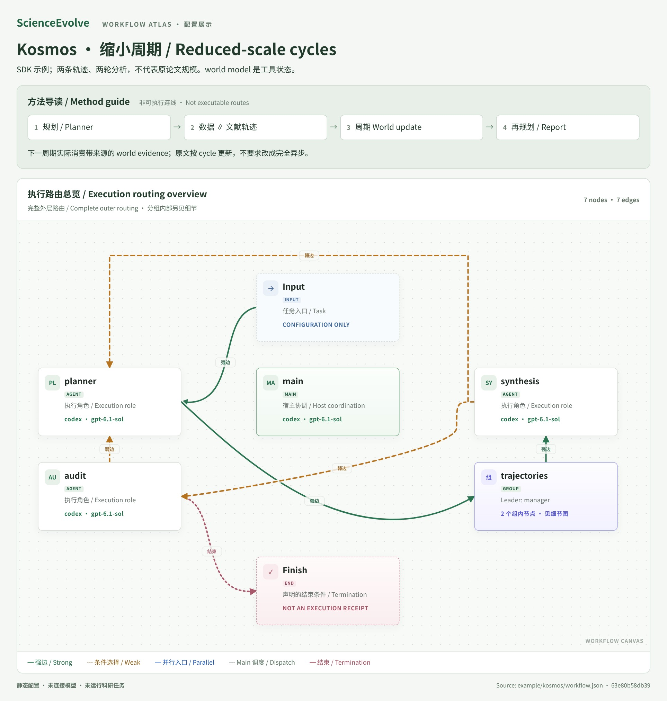
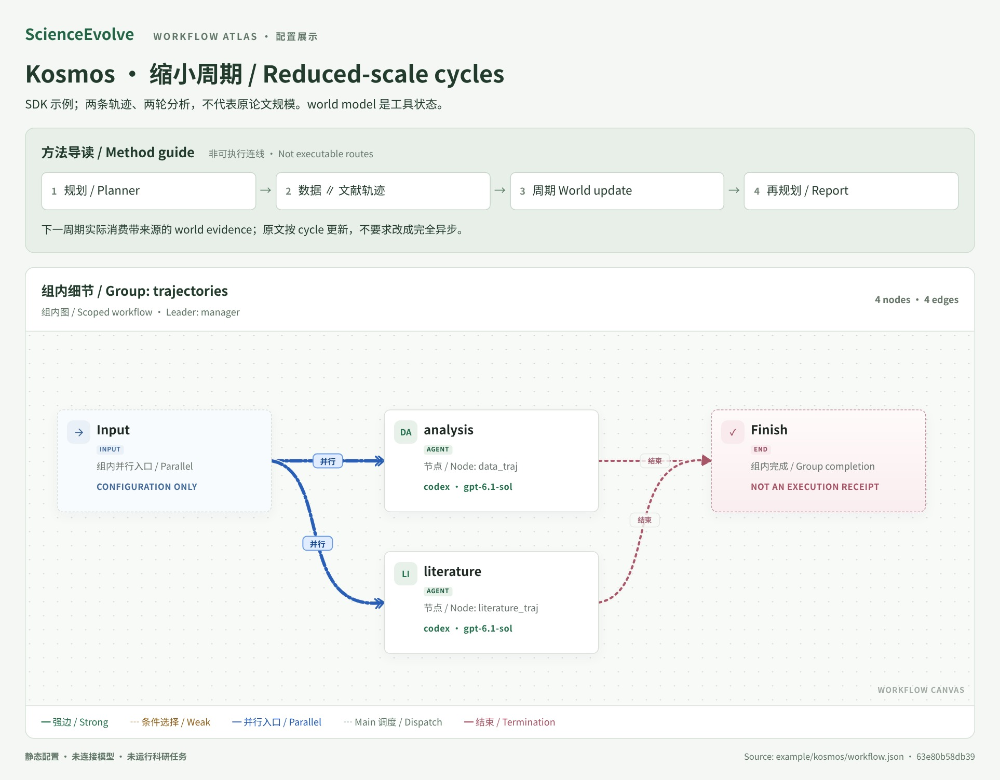

# Kosmos · 缩小周期 / Reduced-scale cycles

[← 画廊 / Gallery](README.md) · [English index](README_en.md) · [Workflow JSON](../../../example/kosmos/workflow.json)

## 方法与边界 / Method and scope

SDK 示例；两条轨迹、两轮分析，不代表原论文规模。world model 是工具状态。

> **方法顺序，不是执行路由 / Method guide, not executable routes**
>
> 规划 / Planner → 数据 ∥ 文献轨迹 → 周期 World update → 再规划 / Report

下一周期实际消费带来源的 world evidence；原文按 cycle 更新，不要求改成完全异步。

[原始依据 / Source](https://arxiv.org/html/2511.02824v1) · [方法映射 / Method mapping](../../../example/METHODS.md#kosmos)

## 执行路由 / Execution routing

真实前端 CanvasWorld / CanvasNodes / CanvasEdges 的文档展示；单独配置展示坐标和可读字号，不改 JSON 路由。不是完整应用界面截图。静态配置，未连接模型或执行科研任务。

先读下方阶段／组内细节；总览用于核对全图。阶段图只显示所选角色之间的真实边，跨阶段边见总览。

展开完整路由总览 / Full routing overview

## 可读细节 / Readable details

### 组内细节 / Group: trajectories

[打开原图 / Open image](kosmos--group-trajectories.jpg)

[完整图片 / Full image](kosmos.jpg) · [来源和截图校验 / Manifest](manifest.json)
