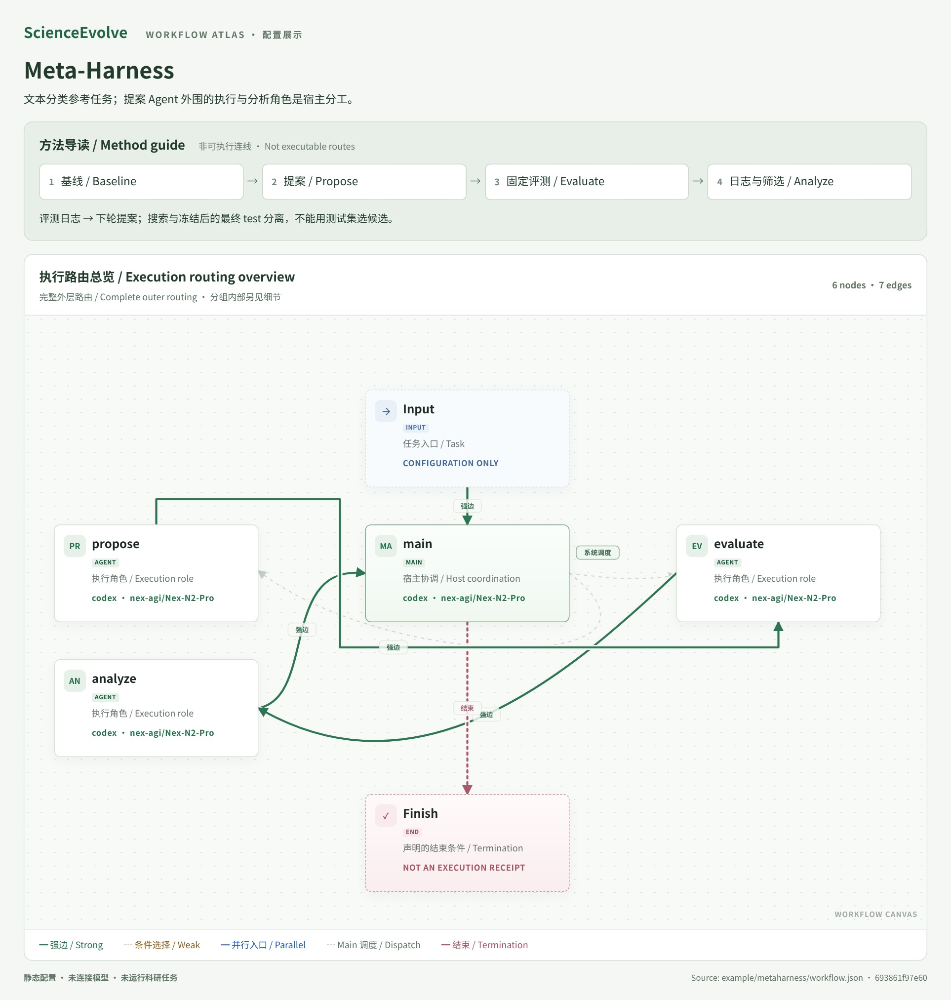

# Meta-Harness

[← 画廊 / Gallery](README.md) · [English index](README_en.md) · [Workflow JSON](../../../example/metaharness/workflow.json)

## 方法与边界 / Method and scope

文本分类参考任务；提案 Agent 外围的执行与分析角色是宿主分工。

> **方法顺序，不是执行路由 / Method guide, not executable routes**
>
> 基线 / Baseline → 提案 / Propose → 固定评测 / Evaluate → 日志与筛选 / Analyze

评测日志 → 下轮提案；搜索与冻结后的最终 test 分离，不能用测试集选候选。

[原始依据 / Source](https://arxiv.org/html/2603.28052v1) · [方法映射 / Method mapping](../../../example/METHODS.md#metaharness)

## 执行路由 / Execution routing

真实前端 CanvasWorld / CanvasNodes / CanvasEdges 的文档展示；单独配置展示坐标和可读字号，不改 JSON 路由。不是完整应用界面截图。静态配置，未连接模型或执行科研任务。

[完整图片 / Full image](metaharness.jpg) · [来源和截图校验 / Manifest](manifest.json)
