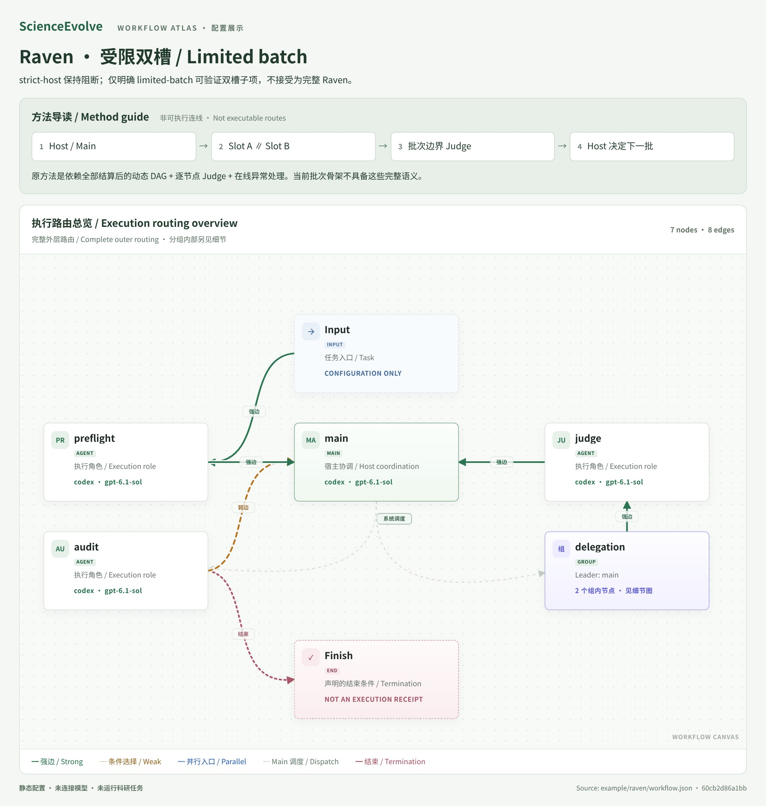
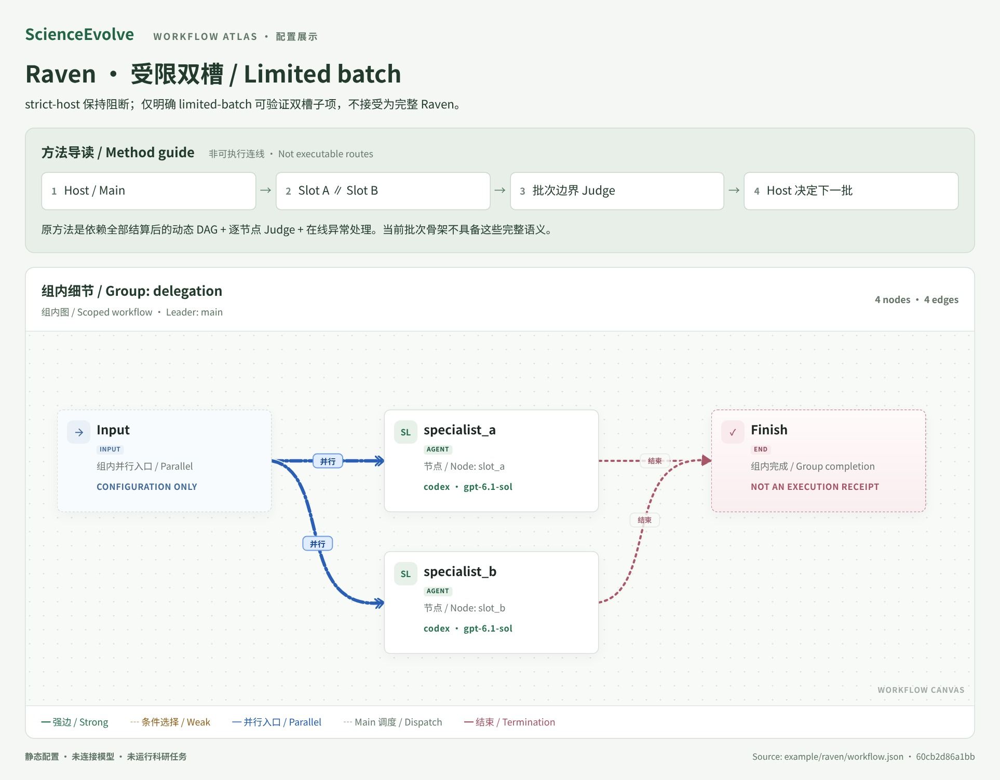

# Raven · 受限双槽 / Limited batch

[← 画廊 / Gallery](README.md) · [English index](README_en.md) · [Workflow JSON](../../../example/raven/workflow.json)

## 方法与边界 / Method and scope

strict-host 保持阻断；仅明确 limited-batch 可验证双槽子项，不接受为完整 Raven。

> **方法顺序，不是执行路由 / Method guide, not executable routes**
>
> Host / Main → Slot A ∥ Slot B → 批次边界 Judge → Host 决定下一批

原方法是依赖全部结算后的动态 DAG + 逐节点 Judge + 在线异常处理。当前批次骨架不具备这些完整语义。

[原始依据 / Source](https://github.com/EverMind-AI/Raven/releases/download/tech-report-v1/technical-report.pdf) · [方法映射 / Method mapping](../../../example/METHODS.md#raven)

## 执行路由 / Execution routing

真实前端 CanvasWorld / CanvasNodes / CanvasEdges 的文档展示；单独配置展示坐标和可读字号，不改 JSON 路由。不是完整应用界面截图。静态配置，未连接模型或执行科研任务。

先读下方阶段／组内细节；总览用于核对全图。阶段图只显示所选角色之间的真实边，跨阶段边见总览。

展开完整路由总览 / Full routing overview

## 可读细节 / Readable details

### 组内细节 / Group: delegation

[打开原图 / Open image](raven--group-delegation.jpg)

[完整图片 / Full image](raven.jpg) · [来源和截图校验 / Manifest](manifest.json)
