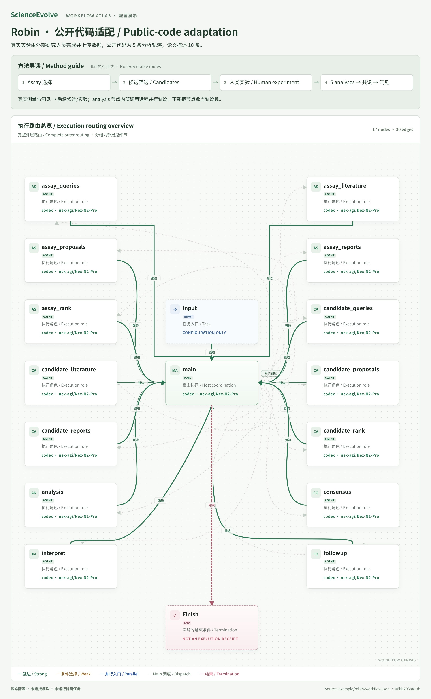
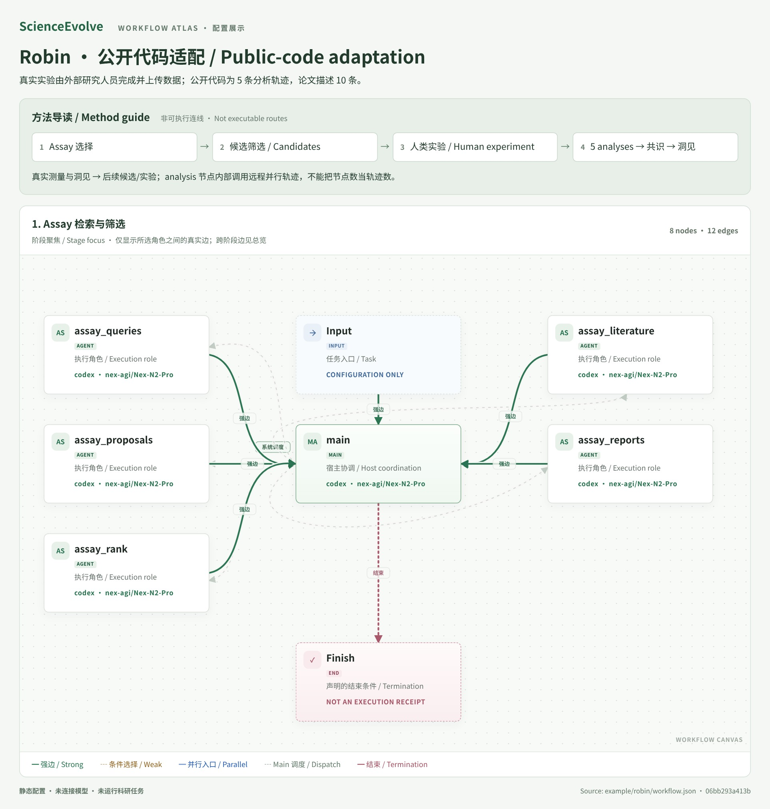
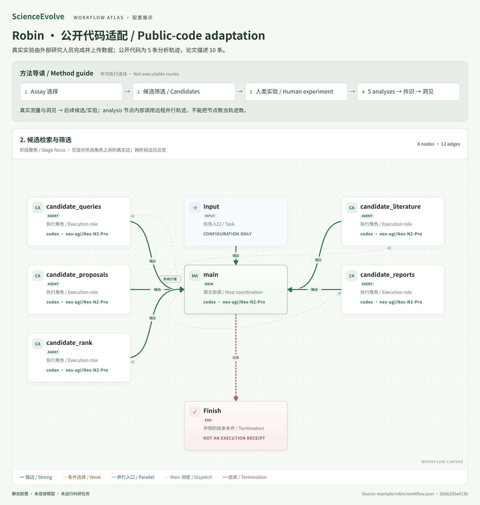
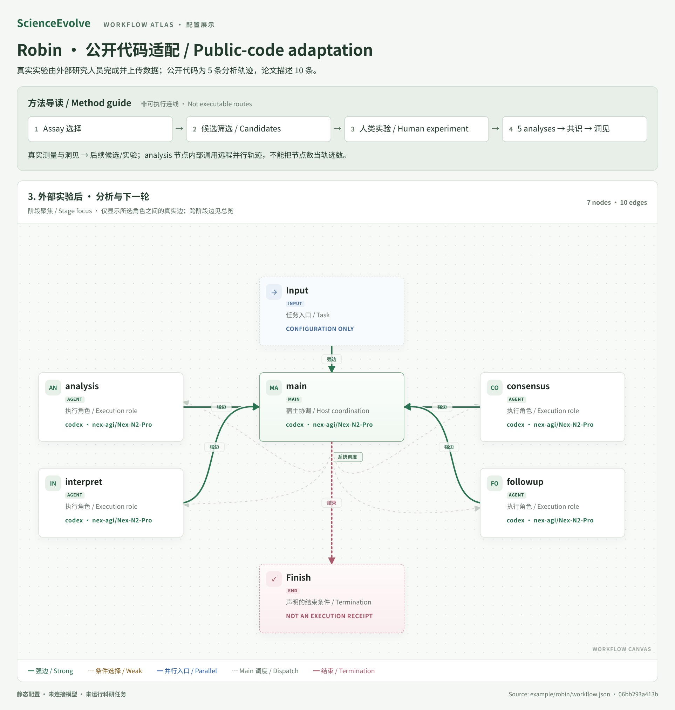

# Robin · 公开代码适配 / Public-code adaptation

[← 画廊 / Gallery](README.md) · [English index](README_en.md) · [Workflow JSON](../../../example/robin/workflow.json)

## 方法与边界 / Method and scope

真实实验由外部研究人员完成并上传数据；公开代码为 5 条分析轨迹，论文描述 10 条。

> **方法顺序，不是执行路由 / Method guide, not executable routes**
>
> Assay 选择 → 候选筛选 / Candidates → 人类实验 / Human experiment → 5 analyses → 共识 → 洞见

真实测量与洞见 → 后续候选/实验；analysis 节点内部调用远程并行轨迹，不能把节点数当轨迹数。

[原始依据 / Source](https://arxiv.org/html/2505.13400v1) · [方法映射 / Method mapping](../../../example/METHODS.md#robin)

## 执行路由 / Execution routing

真实前端 CanvasWorld / CanvasNodes / CanvasEdges 的文档展示；单独配置展示坐标和可读字号，不改 JSON 路由。不是完整应用界面截图。静态配置，未连接模型或执行科研任务。

先读下方阶段／组内细节；总览用于核对全图。阶段图只显示所选角色之间的真实边，跨阶段边见总览。

展开完整路由总览 / Full routing overview

## 可读细节 / Readable details

### 1. Assay 检索与筛选

[打开原图 / Open image](robin--stage-1.jpg)

### 2. 候选检索与筛选

[打开原图 / Open image](robin--stage-2.jpg)

### 3. 外部实验后 · 分析与下一轮

[打开原图 / Open image](robin--stage-3.jpg)

[完整图片 / Full image](robin.jpg) · [来源和截图校验 / Manifest](manifest.json)
