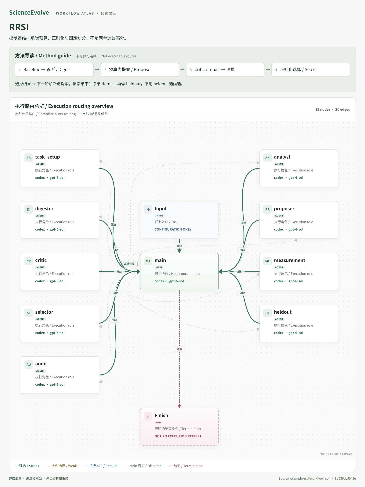
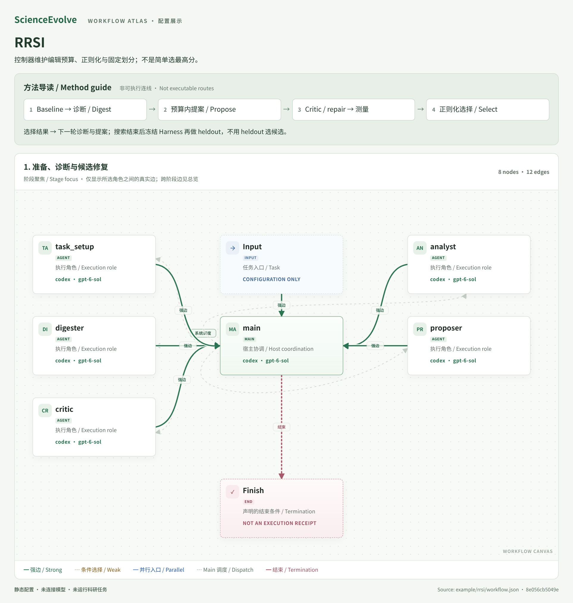
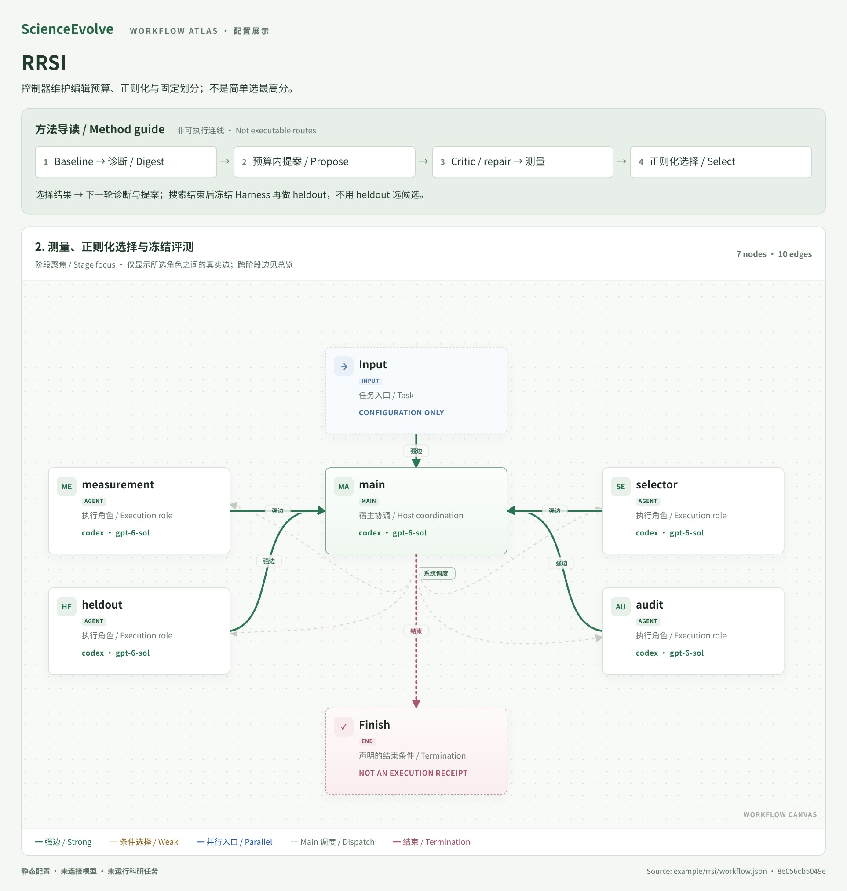

# RRSI

[← 画廊 / Gallery](README.md) · [English index](README_en.md) · [Workflow JSON](../../../example/rrsi/workflow.json)

## 方法与边界 / Method and scope

控制器维护编辑预算、正则化与固定划分；不是简单选最高分。

> **方法顺序，不是执行路由 / Method guide, not executable routes**
>
> Baseline → 诊断 / Digest → 预算内提案 / Propose → Critic / repair → 测量 → 正则化选择 / Select

选择结果 → 下一轮诊断与提案；搜索结束后冻结 Harness 再做 heldout，不用 heldout 选候选。

[原始依据 / Source](https://arxiv.org/html/2609.24972v1) · [方法映射 / Method mapping](../../../example/METHODS.md#rrsi)

## 执行路由 / Execution routing

真实前端 CanvasWorld / CanvasNodes / CanvasEdges 的文档展示；单独配置展示坐标和可读字号，不改 JSON 路由。不是完整应用界面截图。静态配置，未连接模型或执行科研任务。

先读下方阶段／组内细节；总览用于核对全图。阶段图只显示所选角色之间的真实边，跨阶段边见总览。

展开完整路由总览 / Full routing overview

## 可读细节 / Readable details

### 1. 准备、诊断与候选修复

[打开原图 / Open image](rrsi--stage-1.jpg)

### 2. 测量、正则化选择与冻结评测

[打开原图 / Open image](rrsi--stage-2.jpg)

[完整图片 / Full image](rrsi.jpg) · [来源和截图校验 / Manifest](manifest.json)
