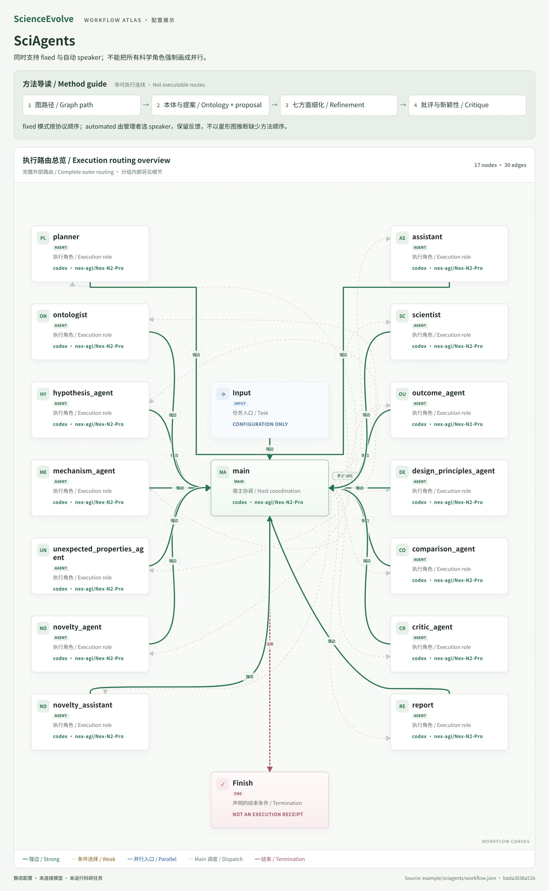
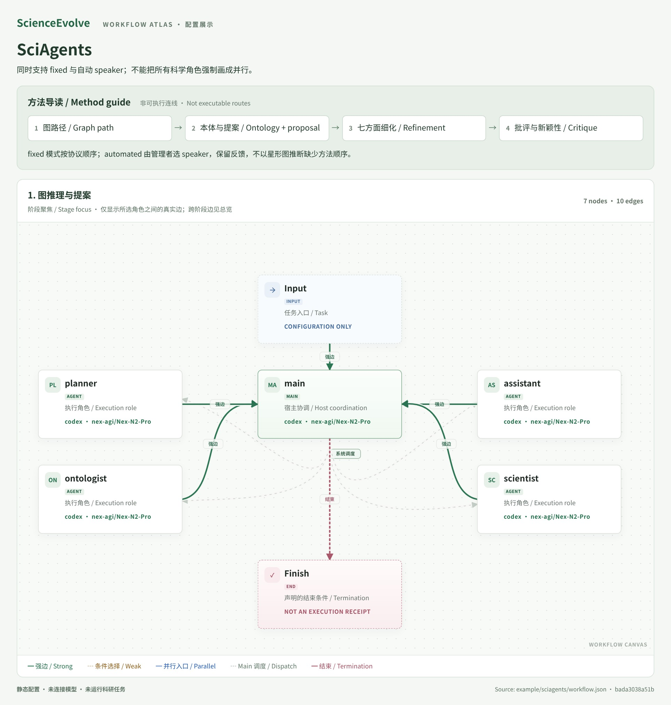
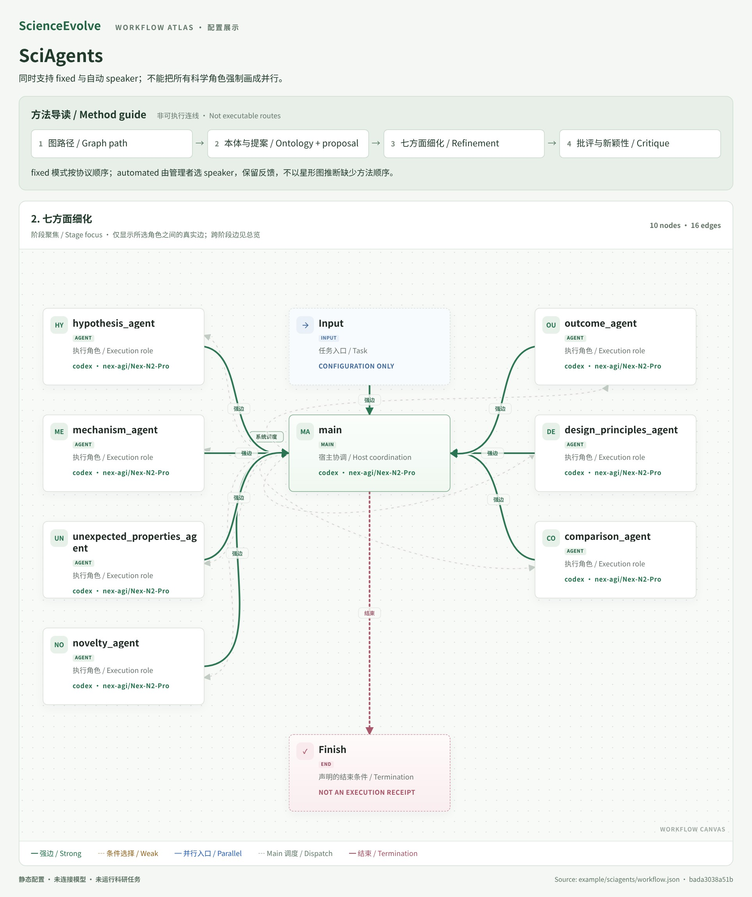
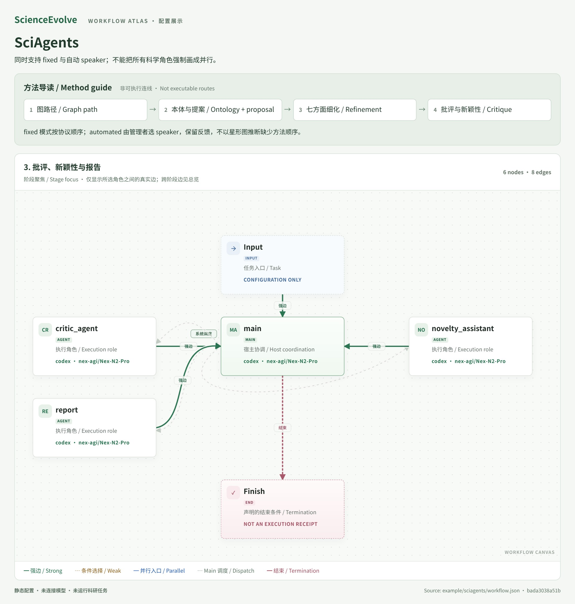

# SciAgents

[← 画廊 / Gallery](README.md) · [English index](README_en.md) · [Workflow JSON](../../../example/sciagents/workflow.json)

## 方法与边界 / Method and scope

同时支持 fixed 与自动 speaker；不能把所有科学角色强制画成并行。

> **方法顺序，不是执行路由 / Method guide, not executable routes**
>
> 图路径 / Graph path → 本体与提案 / Ontology + proposal → 七方面细化 / Refinement → 批评与新颖性 / Critique

fixed 模式按协议顺序；automated 由管理者选 speaker，保留反馈，不以星形图推断缺少方法顺序。

[原始依据 / Source](https://arxiv.org/html/2409.05556v1) · [方法映射 / Method mapping](../../../example/METHODS.md#sciagents)

## 执行路由 / Execution routing

真实前端 CanvasWorld / CanvasNodes / CanvasEdges 的文档展示；单独配置展示坐标和可读字号，不改 JSON 路由。不是完整应用界面截图。静态配置，未连接模型或执行科研任务。

先读下方阶段／组内细节；总览用于核对全图。阶段图只显示所选角色之间的真实边，跨阶段边见总览。

展开完整路由总览 / Full routing overview

## 可读细节 / Readable details

### 1. 图推理与提案

[打开原图 / Open image](sciagents--stage-1.jpg)

### 2. 七方面细化

[打开原图 / Open image](sciagents--stage-2.jpg)

### 3. 批评、新颖性与报告

[打开原图 / Open image](sciagents--stage-3.jpg)

[完整图片 / Full image](sciagents.jpg) · [来源和截图校验 / Manifest](manifest.json)
