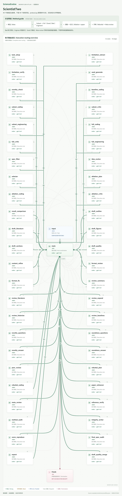
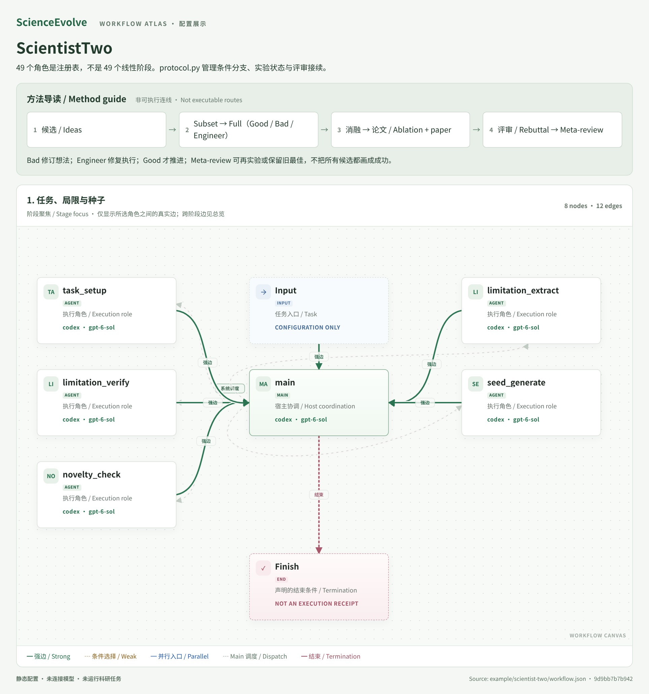
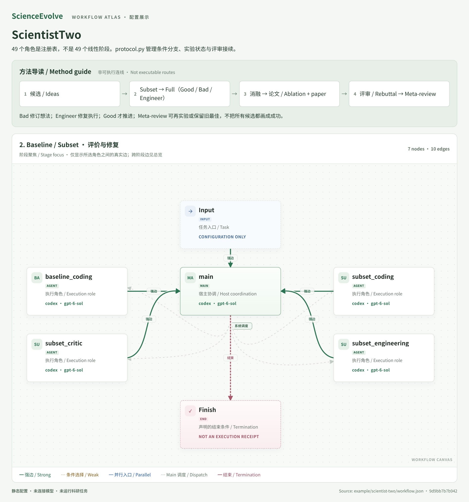
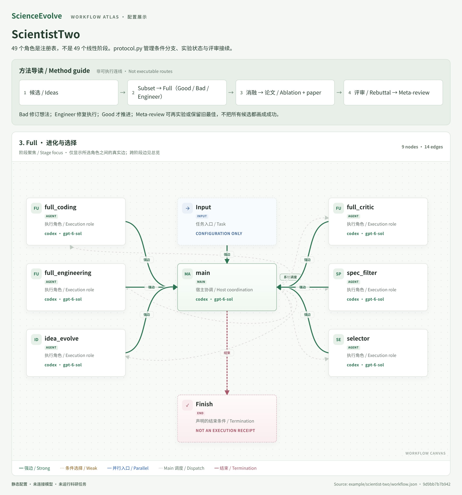
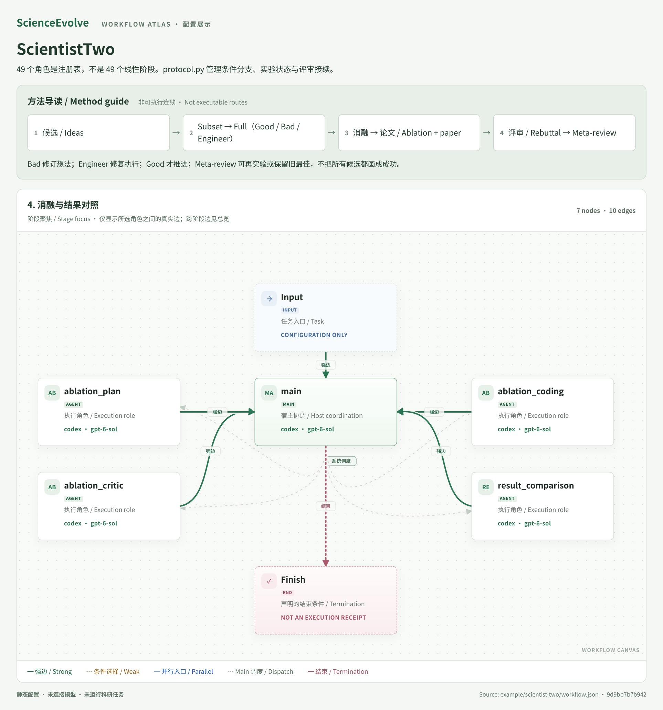
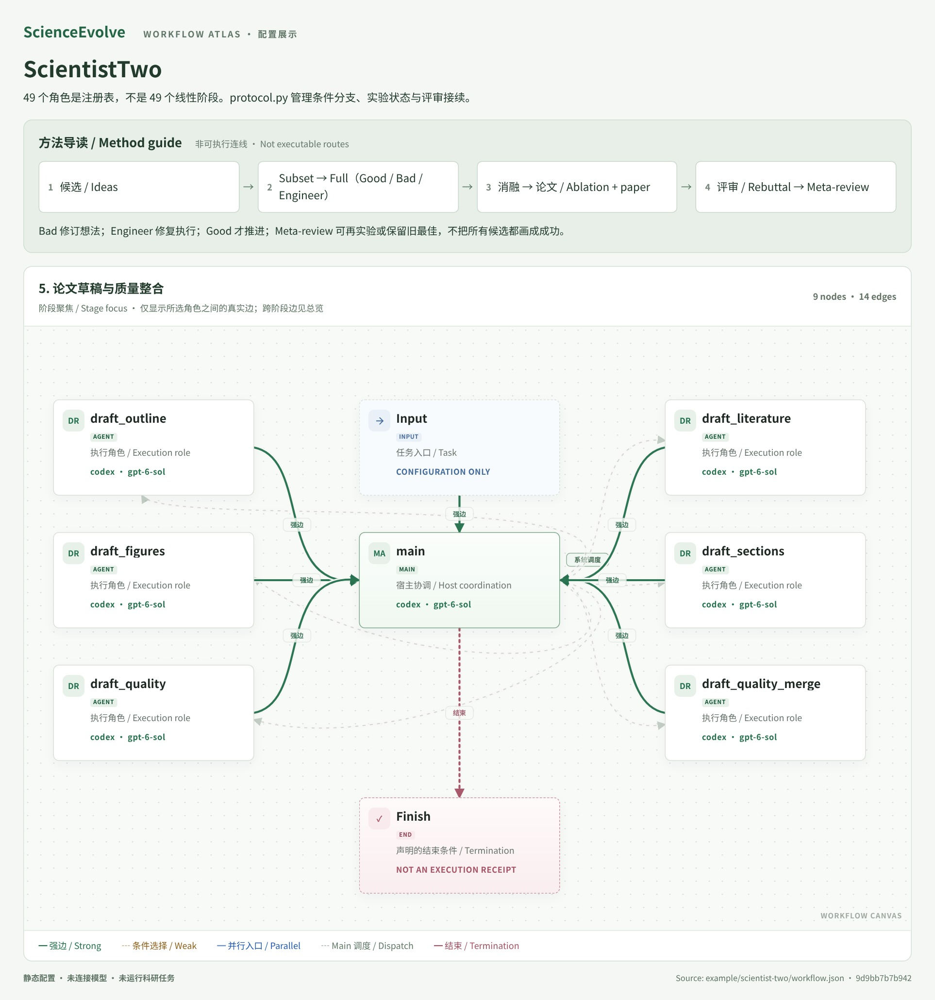
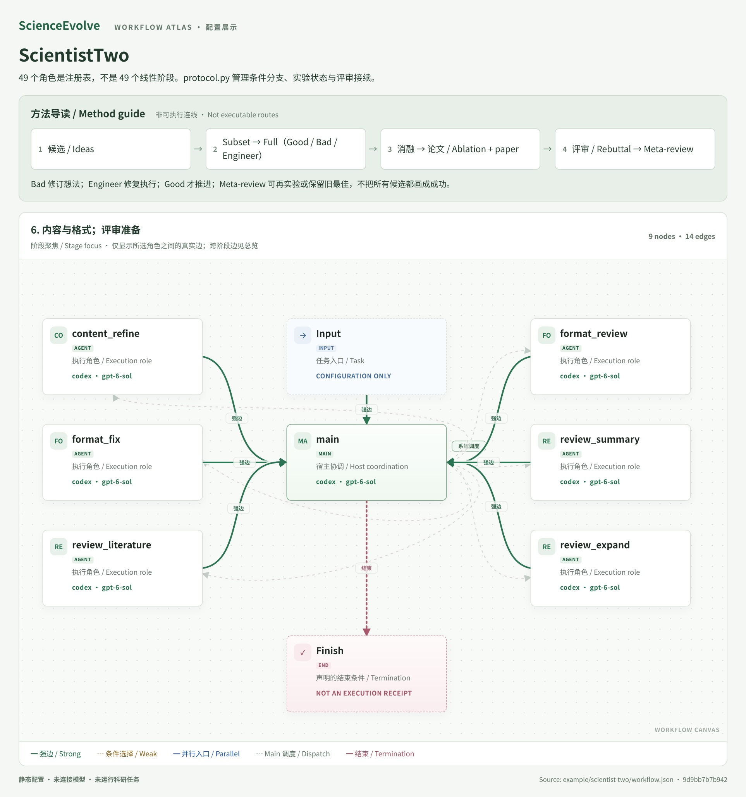
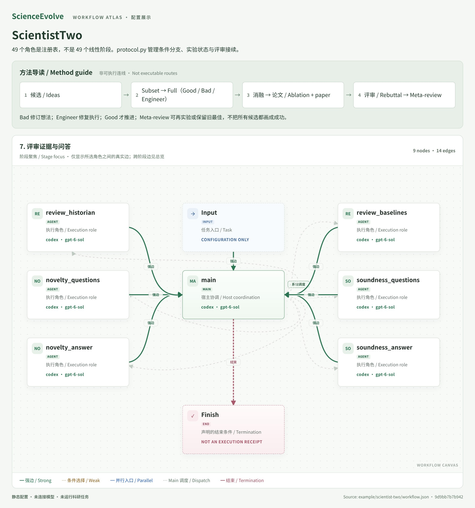
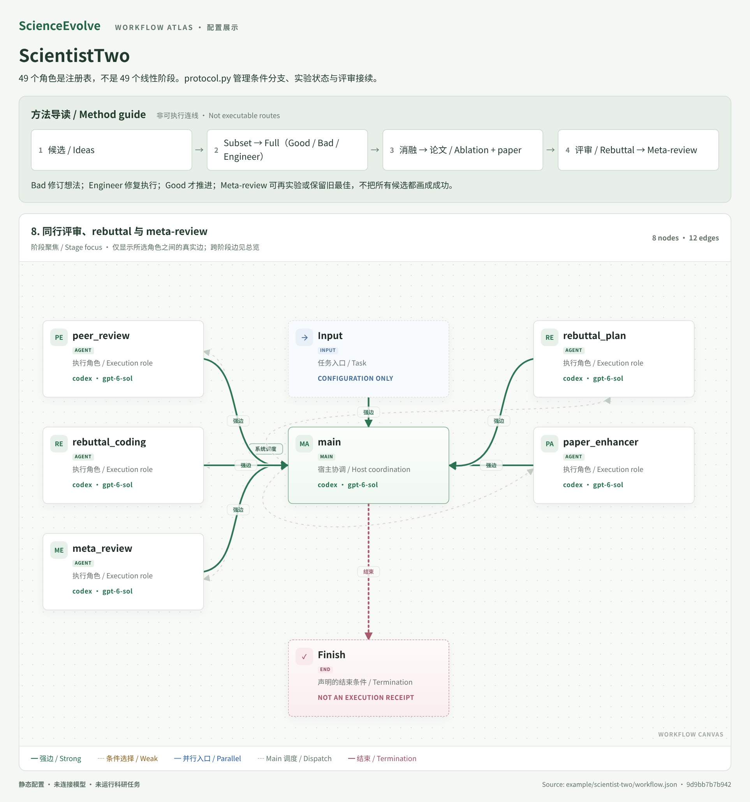

# ScientistTwo

[← 画廊 / Gallery](README.md) · [English index](README_en.md) · [Workflow JSON](../../../example/scientist-two/workflow.json)

## 方法与边界 / Method and scope

49 个角色是注册表，不是 49 个线性阶段。protocol.py 管理条件分支、实验状态与评审接续。

> **方法顺序，不是执行路由 / Method guide, not executable routes**
>
> 候选 / Ideas → Subset → Full（Good / Bad / Engineer） → 消融 → 论文 / Ablation + paper → 评审 / Rebuttal → Meta-review

Bad 修订想法；Engineer 修复执行；Good 才推进；Meta-review 可再实验或保留旧最佳，不把所有候选都画成成功。

[原始依据 / Source](https://arxiv.org/html/2609.19644v1) · [方法映射 / Method mapping](../../../example/METHODS.md#scientist-two)

## 执行路由 / Execution routing

真实前端 CanvasWorld / CanvasNodes / CanvasEdges 的文档展示；单独配置展示坐标和可读字号，不改 JSON 路由。不是完整应用界面截图。静态配置，未连接模型或执行科研任务。

先读下方阶段／组内细节；总览用于核对全图。阶段图只显示所选角色之间的真实边，跨阶段边见总览。

展开完整路由总览 / Full routing overview

## 可读细节 / Readable details

### 1. 任务、局限与种子

[打开原图 / Open image](scientist-two--stage-1.jpg)

### 2. Baseline / Subset · 评价与修复

[打开原图 / Open image](scientist-two--stage-2.jpg)

### 3. Full · 进化与选择

[打开原图 / Open image](scientist-two--stage-3.jpg)

### 4. 消融与结果对照

[打开原图 / Open image](scientist-two--stage-4.jpg)

### 5. 论文草稿与质量整合

[打开原图 / Open image](scientist-two--stage-5.jpg)

### 6. 内容与格式；评审准备

[打开原图 / Open image](scientist-two--stage-6.jpg)

### 7. 评审证据与问答

[打开原图 / Open image](scientist-two--stage-7.jpg)

### 8. 同行评审、rebuttal 与 meta-review

[打开原图 / Open image](scientist-two--stage-8.jpg)

### 9. 引用、方法与最终审计

[打开原图 / Open image](scientist-two--stage-9.jpg)

[完整图片 / Full image](scientist-two.jpg) · [来源和截图校验 / Manifest](manifest.json)
